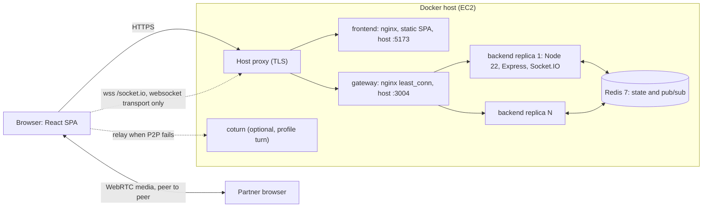

# Chizzy

Chizzy is an anonymous, topic-based video chat: pick a name, a few topics and
(optionally) who you want to meet, and get matched with a stranger for a
peer-to-peer WebRTC call with text chat on the side.

Live: https://chizzy.itsyash.space (socket server: https://chizzyapi.itsyash.space)

## Features

- Matchmaking on shared topics, with mutual gender and language filters.
- Accept or pass on every match (5 second window), skip at any time.
- Peer-to-peer audio and video (WebRTC). STUN by default, optional TURN relay
  with short-lived credentials issued by the backend.
- Text chat with a typing indicator, and a text-only mode that really stops
  sending your camera.
- Reporting: reports are stored, the pair is blocked, and a device reported by
  three different devices within 24 hours is banned for 24 hours.
- Coins (+5 per full minute in a call) and Friends (after 5 minutes together),
  stored on the server per anonymous device.
- Horizontal scaling: N backend replicas share state through Redis.

## Architecture



- The SPA connects to the socket server with the **websocket transport only**.
  Socket.IO needs sticky sessions only for HTTP long-polling, so without polling
  the gateway can use `least_conn` with no stickiness. (`ip_hash` would pin every
  client to one replica, because behind the host proxy all traffic arrives from
  one address.)
- Matchmaking state (sessions, the waiting queue, rooms, blocks, reports, bans,
  coins, friends) lives in Redis. The `@socket.io/redis-adapter` delivers events
  to sockets connected to other replicas. Without `REDIS_URL` the backend uses an
  in-memory store and no adapter (single instance: local dev and tests).
- Media never touches the servers unless a TURN relay is needed.

## Repository layout

| path | what |
|---|---|
| `backend/` | Socket.IO signaling and matchmaking server (TypeScript; bun for install, build and tests; Node 22 in production) |
| `backend/src/protocol.ts` | the socket protocol: event names, payload schemas (zod), limits. Source of truth |
| `new-frontend/` | React + Vite SPA (npm) |
| `new-frontend/src/lib/protocol.ts` | byte-for-byte copy of the protocol, kept in sync by `scripts/sync-protocol.sh` |
| `docker-compose.yml` | production stack: redis, backend replicas, gateway, frontend, optional coturn |
| `deploy/` | gateway nginx config and the host deploy script |
| `.github/workflows/` | CI (`ci.yml`) and the EC2 deploy (`deploy.yml`) |

## Quick start (local development)

Requirements: Bun 1.4, Node 22, npm, and Docker if you want Redis or the full stack.

```sh
# Backend: http://localhost:3004 (in-memory store, CORS "*" outside production)
cd backend
bun install
bun run dev

# Frontend, in another terminal
cd new-frontend
npm ci
npm run dev        # open the URL Vite prints
```

In development the frontend talks to `http://localhost:3004` unless
`VITE_API_URL` is set (for example in `new-frontend/.env.local`). Two browser
windows (one in a private window, so each gets its own device id) can match
each other.

To run the backend against Redis locally:

```sh
docker run --rm -p 6379:6379 redis:7.4.11-alpine
REDIS_URL=redis://localhost:6379 bun run dev
```

## Full stack with Docker Compose

```sh
cp .env.example .env          # defaults work for localhost
docker compose up --build     # redis, 2 backend replicas, gateway, frontend
```

- Frontend: http://localhost:5173
- Socket server (gateway): http://localhost:3004, health at `/healthz` and `/readyz`
- Scale the backend: `BACKEND_REPLICAS=4 docker compose up -d` (the gateway
  re-resolves the replicas every 10 seconds, no reload needed).
- Optional TURN relay: `docker compose --profile turn up -d` (see below).

## Configuration

### Backend environment

Parsed and validated at startup (`backend/src/config.ts`); an invalid value
stops the process with a clear message. Empty values mean "use the default".

| var | default | notes |
|---|---|---|
| NODE_ENV | development | |
| PORT | 3004 | |
| CORS_ORIGINS | `*` outside production | comma list; REQUIRED in production, `*` rejected in production |
| REDIS_URL | unset | set -> RedisStore + redis adapter |
| TRUST_PROXY | false | true -> client IP from `X-Real-IP` (set by our gateway) |
| MAX_CONNECTIONS_PER_IP | 10 | per instance |
| MATCH_ACCEPT_TIMEOUT_MS | 30000 | how long both users have to press Accept |
| STUN_URLS | stun:stun.l.google.com:19302,stun:stun1.l.google.com:19302 | comma list |
| TURN_URLS | unset | comma list, e.g. turn:turn.example.com:3478?transport=udp,turns:turn.example.com:5349 |
| TURN_SECRET | unset | coturn `use-auth-secret` shared secret: issue `username = <expiry>:<deviceId>`, `credential = base64(HMAC-SHA1(secret, username))` |
| TURN_USERNAME / TURN_CREDENTIAL | unset | static alternative to TURN_SECRET |
| TURN_TTL_SECONDS | 43200 | |
| LOG_LEVEL | info | pino |
| METRICS_TOKEN | unset | |
| SHUTDOWN_GRACE_MS | 10000 | |

### Frontend build

| var | default | notes |
|---|---|---|
| VITE_API_URL | `http://localhost:3004` in dev, `https://chizzyapi.itsyash.space` in production builds | socket server origin, baked in at build time (`--build-arg VITE_API_URL=...` for the image). The frontend nginx derives its CSP `connect-src` from the same value. |

### Compose and deploy

`docker-compose.yml` reads `.env` next to it. Every variable is listed with its
default in [`.env.example`](.env.example). The ones that matter most:

| var | default | notes |
|---|---|---|
| BACKEND_IMAGE / FRONTEND_IMAGE | chizzy-backend / chizzy-frontend | image names; the deploy uses the Docker Hub names |
| IMAGE_TAG | latest | the deploy pins the commit sha |
| BACKEND_REPLICAS | 2 | backend instances behind the gateway |
| BACKEND_PORT / FRONTEND_PORT | 3004 / 5173 | host ports of the gateway and the frontend |
| BIND_ADDRESS | 0.0.0.0 | set `127.0.0.1` when a host proxy terminates TLS in front, so nobody can reach the containers around it |
| CORS_ORIGINS | http://localhost:5173 | the public frontend origin in production |
| REDIS_PASSWORD | unset | optional, URL safe; Redis is only on the internal network either way |
| TURN_REALM, TURN_EXTERNAL_IP, TURN_MIN_PORT, TURN_MAX_PORT | chizzy, unset, 49160, 49200 | coturn service (profile `turn`) |

Inside compose the backend always runs with `NODE_ENV=production`,
`TRUST_PROXY=true` (the gateway sets `X-Real-IP` to the real client address,
taken from `X-Forwarded-For` only when the request comes from a private
address such as the host proxy) and `REDIS_URL` pointing at the redis service.

## Scripts

| backend (`bun run ...`) | |
|---|---|
| `dev` | watch mode on `src/index.ts` (Bun) |
| `build` | compile to `dist/` |
| `start` | `node dist/index.js` (production runtime) |
| `typecheck` / `lint` | `tsc --noEmit` / ESLint |
| `bun test` | unit and integration tests; Redis suites run only when `REDIS_URL` is set |
| `test:node` | boots the built server under Node and checks oversized websocket frames are rejected |

| frontend (`npm run ...`) | |
|---|---|
| `dev` / `build` | Vite dev server / production build |
| `typecheck` / `lint` | `tsc` on the app and the e2e suite / ESLint |
| `test` | Vitest |
| `test:e2e` | Playwright: pairs of fake-media Chromium users against the built backend |

`scripts/sync-protocol.sh` copies the protocol to the frontend;
`scripts/sync-protocol.sh --check` fails when the copies differ (CI runs it).

## Testing

```sh
cd backend && bun run typecheck && bun run lint && bun test
cd backend && REDIS_URL=redis://localhost:6379 bun test    # plus the Redis store and two-instance suites
cd backend && bun run build && bun run test:node
cd new-frontend && npm run typecheck && npm run lint && npm test && npm run build
cd new-frontend && npx playwright install chromium && npm run test:e2e
```

The end-to-end suite (`new-frontend/e2e/`) drives two separate Chromium
contexts with fake camera and microphone through the real flows: onboarding,
match and countdown, accept with remote video actually playing on both sides,
chat with typing and server acks, text-only mode, Skip, Pass, the accept
timeout, Report, a partner closing the tab, and Home releasing the camera.
Every test also fails on uncaught page errors, console errors and CSP
violations. By default Playwright builds and starts the backend on Node
(ports 3104 and 3105, the latter with a 3 s accept window for the timeout
test) and serves production builds of the frontend with `vite preview` on
ports 4173 and 4174, with the same security headers nginx sends in
production. To test a running stack instead, set `E2E_BASE_URL` (and
optionally `E2E_TIMEOUT_BASE_URL` and `E2E_ACCEPT_TIMEOUT_MS`); no servers are
started then. The HTML report lands in `new-frontend/playwright-report/`.

CI (`.github/workflows/ci.yml`) runs all of the above on every pull request
and push, with a Redis service container, plus the protocol sync check, both
Docker image builds, `docker compose config` and `nginx -t` on the gateway
config.

## Socket protocol

All events, payload schemas and limits are in
[`backend/src/protocol.ts`](backend/src/protocol.ts). Every client payload is
validated with zod; the server derives everything it can itself (room
membership, timestamps, coins). In short:

- `session:hello` (profile + preferences + deviceId) -> ack with coins and ICE
  servers, then the client is queued. Sent again on every reconnect.
- `match:found` -> `match:accept` / `match:decline` -> `call:start` (exactly
  one side is the initiator) -> `rtc:signal` relays offer, answer and ICE
  candidates between the two members of an active room only.
- `call:connected` once each side's peer connection is up. Coins and friends
  count from when both sides have sent it, so a call whose media never
  connects earns nothing.
- `chat:send` / `chat:message`, `chat:typing`, `call:skip`, `report:submit`,
  `session:preferences`.
- Server notices: `match:ended` (with a reason), `coins:update`, `friends:new`,
  `session:replaced`, `server:shutdown`, `server:error`.

## Scaling notes

- Run more replicas with `BACKEND_REPLICAS`. Any replica can serve any client:
  sessions and rooms are in Redis, cross-replica events go through the Redis
  adapter, and each replica heartbeats so sessions of a dead replica are
  cleaned up and their partners notified.
- No sticky sessions: clients use the websocket transport only. If you put
  another load balancer in front and need long-polling, it must hash on
  something stable per client (not the source IP, which is the proxy's).
- Readiness: `GET /readyz` answers 503 when the store (Redis) is unreachable.
  Liveness: `GET /healthz` (alias `/health`).
- Metrics: `GET /metrics` on each replica (Prometheus text, optional bearer
  token `METRICS_TOKEN`). The gateway does not expose `/metrics`; scrape the
  replicas on the compose network.
- Redis runs with append-only persistence on the `redis-data` volume.

## TURN setup

STUN is enough for most home networks, but users behind symmetric NAT,
carrier-grade NAT or UDP-blocking firewalls need a TURN relay.

1. Pick a secret: `openssl rand -hex 32`.
2. Set `TURN_SECRET`, `TURN_URLS` (for example
   `turn:<host>:3478?transport=udp,turn:<host>:3478?transport=tcp`) and, on
   EC2, `TURN_EXTERNAL_IP=<public-ip>/<private-ip>` in `.env` (or the GitHub
   secrets, see DEPLOYMENT.md).
3. Open 3478 tcp+udp and the relay range `TURN_MIN_PORT`-`TURN_MAX_PORT` udp
   (default 49160-49200) in the security group.
4. `docker compose --profile turn up -d`.

The backend then returns short-lived credentials (`TURN_TTL_SECONDS`) in the
`session:hello` ack. The coturn service refuses to relay to private, loopback
and link-local addresses, so it cannot be used to reach the host's network.
TLS (`turns:` on 5349 or 443) needs certificates mounted into coturn and is
not set up by default.

## Known limitations

- Identity is an anonymous device id stored in the browser. It is easy to
  reset or spoof, so bans, coins and friends are best-effort per browser. Real
  enforcement needs accounts.
- A deploy restarts the backend replicas, which drops live calls; clients show
  "Reconnecting" and are re-queued automatically.
- Moderation is report-based only; there is no content scanning.
- Without a TURN relay some users on restrictive networks cannot connect.

## More

- [DEPLOYMENT.md](DEPLOYMENT.md): CI/CD, GitHub secrets, host setup, rollback.
- [SECURITY.md](SECURITY.md): reporting vulnerabilities and the security model.
