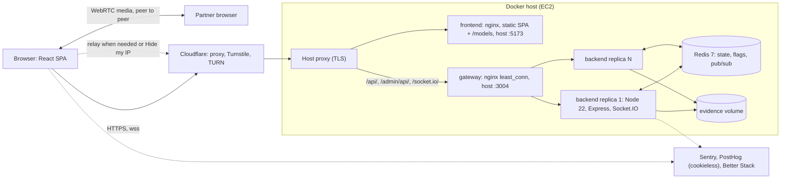

# Chizzy

Chizzy is an anonymous, topic-based video chat for adults (18+): pass a short
age and Terms gate, pick a name, a few topics and (optionally) who you want to
meet, and get matched with a stranger for a peer-to-peer WebRTC call with
text chat on the side.

Live: https://chizzy.itsyash.space (API and socket server: https://chizzyapi.itsyash.space).
Free-tier mirror: https://chizzy-chat.vercel.app (API: https://chizzy-api.onrender.com), see [Free hosting](#free-hosting-vercel--render).

## Features (v1 launch build)

The scope and the owner decisions behind it are in `.planning/BUILD_V1.md`
(local planning notes) and [docs/safety-decision-log.md](docs/safety-decision-log.md).

- **Session gate** before the camera: date of birth (the server computes 18+
  and does not store the date), 18+ attestation, Terms acceptance, Cloudflare
  Turnstile, a country blocklist and an under-18 device lockout. The server
  returns a signed session token that the socket handshake requires.
- **Matching** on shared topics and language, with the gender and language
  filters as hard constraints and a relaxation ladder for topics. Instant mode
  by default (the call starts blurred), Preview mode (an accept card) as an
  option; free, unlimited Next.
- **Peer-to-peer audio and video** (WebRTC) with Cloudflare TURN for networks
  that need a relay. TURN credentials are issued per matched call only.
  "Hide my IP" forces the relay so the partner does not see your IP address.
- **On-device moderation**: the partner's video starts blurred and unblurs
  after the receiver's classifier sees several safe frames; the sender's
  video is paused when no face is visible. Models are self-hosted under
  `/models/`. These checks reduce exposure; they do not catch everything.
- **Safety UX**: links, handles and phone numbers in chat are hidden for the
  first 2 minutes, display names go through a name guard, safety nudges and a
  first-use safety card with helplines, a faint session watermark on the
  remote video.
- **Reports with evidence** (one tap on the video, the match card and a 60 s
  post-call screen), reporter weighting, a graduated restriction ladder,
  a restriction screen with the reason and a free appeal, NCII takedown
  tickets, and a CSAM escalation path that builds a report packet without
  anyone opening the image.
- **Admin console** at `/admin` (a lazy part of the SPA) over `/admin/api/*`
  on the API origin: the review queue with SLA timers, appeals, takedowns,
  the flags editor and the audit log.
- **Operator flags**: a kill switch for matching and new sessions, staffed
  hours, a banner, the country blocklist, TURN and bitrate caps, the default
  match mode. Changed in the admin console, cached 2 s per instance.
- Text chat with a typing indicator, a text-only mode, coins and Friends
  (kept as built, owner decision D-2).
- Horizontal scaling: N backend replicas share state through Redis.

## Architecture



- **Cloudflare in front of both hostnames.** The SPA and the API are proxied
  by Cloudflare. The country blocklist reads Cloudflare's `CF-IPCountry`
  header (`TRUST_CLOUDFLARE=true`), and the gateway believes the `CF-*`
  headers only from Cloudflare's published ranges. With `CLOUDFLARE_ONLY=true`
  the gateway also refuses requests that did not come through Cloudflare, so
  nobody can skip the blocklist by calling the origin directly
  ([DEPLOYMENT.md](DEPLOYMENT.md#cloudflare-in-front)).
- **Session gate.** `POST /api/session` -> signed session token ->
  Socket.IO handshake with `auth.sessionToken`. `GET /api/config` gives the
  SPA its public runtime settings (Turnstile site key, Sentry DSN, PostHog
  key, banner, staffed hours, default mode).
- **Gateway.** Clients use the websocket transport only, so the gateway uses
  `least_conn` with no stickiness. REST (`/api/`, `/admin/api/`) goes to the
  same upstream with a 64 KB body cap. Report evidence travels inside the
  socket, never as REST.
- **TURN provider.** Cloudflare Realtime TURN (`TURN_PROVIDER=cloudflare`).
  Nothing relays media on the app host; the old coturn service was removed
  (a vulnerable image, and a relay that saturates the NIC takes signaling
  down with it).
- **State.** Sessions, the queue, rooms, flags, restrictions, reports
  metadata, appeals, takedowns and the audit log live in Redis; the
  `@socket.io/redis-adapter` delivers events across replicas. Evidence frames
  live on the `evidence-data` volume (or S3). Without `REDIS_URL` the backend
  runs in memory (single instance: local dev and tests).

## Repository layout

| path | what |
|---|---|
| `backend/` | API, signaling and matchmaking server (TypeScript; bun for install, build and tests; Node 22 in production) |
| `backend/src/protocol.ts` | protocol v3: socket events, REST schemas, admin types, flags. Source of truth |
| `new-frontend/` | React + Vite SPA (npm), including the admin console |
| `new-frontend/src/lib/protocol.ts` | byte-for-byte copy of the protocol, kept in sync by `scripts/sync-protocol.sh` |
| `docker-compose.yml` | production stack: redis, backend replicas, gateway, frontend |
| `deploy/` | gateway nginx configs, the Cloudflare IP script and the host deploy script |
| `scripts/` | protocol sync, lockfile check, Redis backup and restore, `loadtest/` (load test and canary) |
| `docs/` | runbooks, capacity, retention, risk assessment, safety decision log, launch checklist |
| `docs/engineering-conventions.md` | backend module boundaries, the constants and enums-as-const rules, the patterns in use, test layering and the add-a-feature checklist |
| `.github/workflows/` | CI (`ci.yml`), the EC2 deploy (`deploy.yml`), the synthetic canary (`canary.yml`), the free-tier pinger (`keepalive.yml`) |
| `render.yaml`, `new-frontend/vercel.json` | the free-tier deployment: backend on Render, frontend on Vercel |

## Quick start (local development)

Requirements: Bun 1.4, Node 22, npm, and Docker if you want Redis or the full stack.

```sh
# Backend: http://localhost:3004 (in-memory store, CORS "*" outside production)
cd backend
bun install
bun run dev

# Frontend, in another terminal
cd new-frontend
npm ci
npm run dev        # open the URL Vite prints
```

In development the frontend talks to `http://localhost:3004` unless
`VITE_API_URL` is set (for example in `new-frontend/.env.local`). Two browser
windows (one in a private window, so each gets its own device id) can match
each other. For a local Turnstile widget use Cloudflare's test keys: site key
`1x00000000000000000000AA` with secret `1x0000000000000000000000000000000AA`
(always passes) or `2x0000000000000000000000000000000AA` (always fails).

To run the backend against Redis locally:

```sh
docker run --rm -p 6379:6379 redis:7.4.11-alpine
REDIS_URL=redis://localhost:6379 bun run dev
```

## Full stack with Docker Compose

```sh
cp .env.example .env          # set SESSION_SECRET (openssl rand -hex 32); add Turnstile test keys or TURNSTILE_DISABLED=true
docker compose up --build     # redis, 2 backend replicas, gateway, frontend
```

- Frontend: http://localhost:5173 (admin console at http://localhost:5173/admin)
- API and socket server (gateway): http://localhost:3004, health at `/healthz` and `/readyz`
- Scale the backend: `BACKEND_REPLICAS=4 docker compose up -d` (the gateway
  re-resolves the replicas every 10 seconds, no reload needed).

## Configuration

### Backend environment

Parsed and validated at startup (`backend/src/config.ts`, the source of
truth for defaults); an invalid value stops the process with a clear message.
Empty values mean "use the default". Compose passes every variable below.

| var | default | notes |
|---|---|---|
| NODE_ENV | development | compose sets production |
| PORT | 3004 | |
| CORS_ORIGINS | `*` outside production | comma list; REQUIRED in production, `*` rejected in production |
| REDIS_URL | unset | set -> RedisStore + redis adapter + Redis feature stores |
| TRUST_PROXY | false | true -> client IP from PROXY_IP_HEADER instead of the TCP peer |
| PROXY_IP_HEADER | x-real-ip | header the trusted proxy sets: `X-Real-IP` from our gateway, `True-Client-IP` on Render |
| KEEPALIVE_URL | unset (Render: `$RENDER_EXTERNAL_URL/healthz`) | GET every 10 min so a free host that idles out instances keeps this one running |
| MAX_CONNECTIONS_PER_IP | 10 | per instance |
| CONNECT_BURST_PER_IP / CONNECT_RATE_PER_IP_PER_SEC | 20 / 1 | new connections per client IP per instance (burst, then per second); raise for load tests |
| MATCH_ACCEPT_TIMEOUT_MS | 30000 | Preview mode accept window |
| LOG_LEVEL / METRICS_TOKEN / SHUTDOWN_GRACE_MS | info / unset / 10000 | |
| SESSION_SECRET | unset | HMAC key for session and age tokens; required in production (32+ characters) |
| SESSION_SECRET_PREVIOUS | unset | old key still accepted during a rotation |
| TURNSTILE_SITE_KEY / TURNSTILE_SECRET | unset | Cloudflare Turnstile for the session gate and the takedown form (the site key is served to the SPA via `/api/config`); required in production unless TURNSTILE_DISABLED |
| TURNSTILE_DISABLED | false | load tests and local stacks only |
| SESSION_RATE_PER_IP_PER_MIN / SESSION_RATE_PER_NETWORK_PER_MIN | 10 / 60 | `POST /api/session` per client IP and per /24 (IPv6 /48); raise for e2e and load tests |
| MATCH_CAP_PER_DEVICE_PER_HOUR / MATCH_CAP_PER_IP_PER_HOUR | 200 / 200 | hourly match caps |
| TRUST_CLOUDFLARE | false | read the country from `CF-IPCountry` (only when Cloudflare proxies the API) |
| TURN_PROVIDER | backend default | `cloudflare` (production), or `static` / `secret` with the TURN_* vars |
| CF_TURN_KEY_ID / CF_TURN_API_TOKEN | unset | Cloudflare Realtime TURN key |
| CF_ACCOUNT_ID / CF_ANALYTICS_TOKEN | unset | TURN spend poller (Cloudflare GraphQL analytics) |
| TURN_SPEND_DAILY_GB | 35,50,70 | daily TURN egress thresholds: lower relay bitrate, then Hide my IP off, then TURN off |
| TURN_CACHE_SECONDS | 300 | per-device TURN credential cache |
| TURN_MAX_PER_DEVICE_HOUR / TURN_MAX_PER_IP_HOUR | 20 / 100 | TURN credential sets per hour |
| STUN_URLS | Google public STUN | comma list |
| TURN_URLS, TURN_SECRET, TURN_USERNAME, TURN_CREDENTIAL, TURN_TTL_SECONDS | unset | self-hosted TURN only (not part of this stack) |
| SENTRY_DSN / SENTRY_DSN_FRONTEND | unset | backend DSN / DSN handed to the SPA |
| POSTHOG_KEY / POSTHOG_HOST | unset | handed to the SPA (cookieless, IP capture off) |
| ADMIN_TOKEN | unset | bearer token for `/admin/api/*` (24+ characters); required in production, unset elsewhere keeps the admin API off |
| ADMIN_ALLOWED_IPS | unset | optional comma list of IPs or CIDRs for the admin API |
| PSEUDONYM_SALT | derived from ADMIN_TOKEN | salt for the device pseudonyms admins see (16+ characters); set it once in production |
| EVIDENCE_DIR | compose: `/data/evidence` | the `evidence-data` volume, shared by the replicas |
| EVIDENCE_S3_BUCKET / EVIDENCE_S3_REGION | unset | store evidence in S3 instead (instance role credentials); the region is required with a bucket |
| EVIDENCE_S3_KMS_KEY_ID | unset | SSE-KMS key for evidence objects (SSE-S3 without it) |

### Frontend build

| var | default | notes |
|---|---|---|
| VITE_API_URL | `http://localhost:3004` in dev, `https://chizzyapi.itsyash.space` in production builds | API and socket origin, baked in at build time (`--build-arg VITE_API_URL=...` for the image). The frontend nginx derives its CSP `connect-src` from the same value. |
| VITE_SITE_URL | `https://chizzy.itsyash.space` | Public origin of the site, baked in at build time (`--build-arg VITE_SITE_URL=...`): canonical and link preview (`og:url`, `og:image`) URLs, `sitemap.xml` and `robots.txt`. |

Everything else the SPA needs at runtime (Turnstile site key, Sentry DSN,
PostHog key, banner, staffed hours) comes from `GET /api/config`.

### Compose and deploy

`docker-compose.yml` reads `.env` next to it. Every variable is listed with
its default in [`.env.example`](.env.example). Besides the backend variables
above:

| var | default | notes |
|---|---|---|
| BACKEND_IMAGE / FRONTEND_IMAGE | chizzy-backend / chizzy-frontend | image names; the deploy uses the Docker Hub names |
| IMAGE_TAG | latest | the deploy pins the commit sha |
| BACKEND_REPLICAS | 2 | backend instances behind the gateway |
| BACKEND_PORT / FRONTEND_PORT | 3004 / 5173 | host ports of the gateway and the frontend |
| BIND_ADDRESS | 0.0.0.0 | `127.0.0.1` when a host proxy terminates TLS in front |
| REDIS_PASSWORD | unset | optional, URL safe |
| CLOUDFLARE_ONLY | false | host only: the gateway refuses requests that did not come through Cloudflare |
| BACKUP_S3_URI | unset | host only: where `scripts/backup-redis.sh` uploads snapshots |

Inside compose the backend always runs with `NODE_ENV=production`,
`TRUST_PROXY=true` (the gateway sets `X-Real-IP` to the real client address:
`CF-Connecting-IP` when the request came from a Cloudflare edge, otherwise the
address from `X-Forwarded-For` past private hops such as the host proxy; see
DEPLOYMENT.md) and `REDIS_URL` pointing at the redis service. Backend,
gateway and frontend run with `nofile` 65535; both nginx configs use
`worker_connections 16384` and `worker_rlimit_nofile 65535`.

### Free hosting: Vercel + Render

The whole stack also runs for free, with the limits below: the SPA as a
static site on Vercel (`new-frontend/vercel.json`: build, SPA rewrite and
the same security headers nginx sends, with the Render origin in
`connect-src`) and the backend as a Render Free web service built from
`backend/Dockerfile` (`render.yaml`). Live at https://chizzy-chat.vercel.app
and https://chizzy-api.onrender.com.

- **Vercel** builds `new-frontend` with `VITE_API_URL=https://chizzy-api.onrender.com`
  and `VITE_SITE_URL=https://chizzy-chat.vercel.app` (project environment
  variables). Deploy with `cd new-frontend && vercel deploy --prod`.
- **Render** runs one instance with the in-memory store, `TRUST_PROXY=true`
  with `PROXY_IP_HEADER=true-client-ip` and `TRUST_CLOUDFLARE=true` (Render
  sits behind Cloudflare, so the real IP and `CF-IPCountry` are available),
  and `TURNSTILE_DISABLED=true` until Turnstile keys exist. `CORS_ORIGINS`
  is the Vercel origin.
- **Spin-down.** A Free web service sleeps after 15 minutes without inbound
  traffic and takes about a minute to wake. Two things keep it warm: the
  backend GETs its own `/healthz` every 10 minutes (`KEEPALIVE_URL`, which
  defaults to Render's `RENDER_EXTERNAL_URL`), and `keepalive.yml` curls the
  `KEEPALIVE_URL` repository variable every 10 minutes from GitHub, which also
  wakes a service that already fell asleep. An always-on service uses ~744 of
  the 750 free instance hours a month, so keep it the only running Free
  service in the Render workspace.
- **What you lose on the free tier**: one instance (no replicas), no Redis
  (sessions, bans, flags and reports reset on every deploy or restart, and
  evidence on the ephemeral disk goes with them unless `EVIDENCE_S3_*` is
  set), no Cloudflare TURN until `TURN_PROVIDER=cloudflare` is configured,
  no bot check until Turnstile keys are set.

## Operations

- **Kill switch and flags**: `/admin` -> Flags. `matching_enabled` off stops
  matching (live calls continue), `new_sessions_enabled` off stops new
  sessions, `banner_message` shows a banner, `default_mode` switches Instant
  and Preview, `turn_enabled`, `private_mode_enabled`, `video_max_kbps` and
  `relay_video_max_kbps` control relay cost, `blocked_countries` is the
  country blocklist. Changes reach every replica within about 2 s.
- **Staffed hours**: `staffed_hours` (for example `20:00-24:00 Asia/Kolkata`)
  opens matching only in that window, so the review queue's legal clocks can
  be met by the people on duty. Empty means always open.
- **Runbooks**: [docs/runbooks/](docs/runbooks/) (CSAM escalation, law
  enforcement, NCII takedown, CERT-In incident, TURN cost spike, abuse wave,
  host down).
- **Backups**: nightly `scripts/backup-redis.sh` to S3, restore with
  `scripts/restore-redis.sh` ([docs/redis-backup.md](docs/redis-backup.md)).
- **Capacity**: [docs/capacity.md](docs/capacity.md) and the load test in
  `scripts/loadtest/`.
- **Canary**: `.github/workflows/canary.yml`, opt-in with the `CANARY_URL`
  repository variable.
- **Launch tasks for the owner**: [docs/launch-checklist.md](docs/launch-checklist.md).

## Scripts

| backend (`bun run ...`) | |
|---|---|
| `dev` | watch mode on `src/index.ts` (Bun) |
| `build` | compile to `dist/` |
| `start` | `node dist/index.js` (production runtime) |
| `typecheck` / `lint` | `tsc --noEmit` / ESLint |
| `bun test` | unit and integration tests; Redis suites run only when `REDIS_URL` is set |
| `test:node` | boots the built server under Node and checks oversized websocket frames are rejected |

| frontend (`npm run ...`) | |
|---|---|
| `dev` / `build` | Vite dev server / production build |
| `typecheck` / `lint` | `tsc` on the app and the e2e suite / ESLint |
| `test` | Vitest |
| `test:e2e` | Playwright: pairs of fake-media Chromium users against the built backend |

| repo scripts | |
|---|---|
| `scripts/sync-protocol.sh [--check]` | copy the protocol to the frontend / fail when the copies differ (CI) |
| `scripts/check-lockfiles.sh` | lockfiles must only reference the public npm registry (CI) |
| `node scripts/loadtest/loadtest.ts` | signaling load test ([docs/capacity.md](docs/capacity.md)) |
| `node scripts/loadtest/canary.ts` | two-client synthetic canary (`CANARY_URL`) |
| `scripts/backup-redis.sh`, `scripts/restore-redis.sh` | Redis snapshot to S3 and restore |
| `deploy/cloudflare-ips.sh` | refresh the gateway's Cloudflare ranges and the optional origin lock |

## Testing

```sh
cd backend && bun run typecheck && bun run lint && bun test
cd backend && REDIS_URL=redis://localhost:6379 bun test    # plus the Redis store and two-instance suites
cd backend && bun run build && bun run test:node
cd new-frontend && npm run typecheck && npm run lint && npm test && npm run build
cd new-frontend && npx playwright install chromium && npm run test:e2e
backend/node_modules/.bin/tsc -p scripts/loadtest              # load test and canary typecheck
```

The end-to-end suite (`new-frontend/e2e/`) drives two separate Chromium
contexts with fake camera and microphone through the real flows. Every test
also fails on uncaught page errors, console errors and CSP violations. By
default Playwright builds and starts the backend on Node and serves
production builds of the frontend with `vite preview`, with the same security
headers nginx sends in production (`new-frontend/nginx-security-headers.conf`).
To test a running stack instead, set `E2E_BASE_URL` (and optionally
`E2E_TIMEOUT_BASE_URL` and `E2E_ACCEPT_TIMEOUT_MS`). The HTML report lands in
`new-frontend/playwright-report/`.

CI (`.github/workflows/ci.yml`) runs all of the above on every pull request
and push, with a Redis service container, plus the protocol sync and lockfile
checks, actionlint and shellcheck, both Docker image builds,
`docker compose config` and `nginx -t` on the gateway and frontend configs.
The `stack` job then starts the real compose stack (Redis, two backend
replicas, the gateway and the nginx frontend) and runs the end-to-end suite
against it with `E2E_BASE_URL`.

## Protocol (v3)

All socket events, REST schemas, limits and flags are in
[`backend/src/protocol.ts`](backend/src/protocol.ts). Every client payload is
validated with zod; the server derives everything it can itself. In short:

- `POST /api/session` (Turnstile token, device id, date of birth or age token,
  ToS version) -> session token; `GET /api/config` for public settings.
- Socket handshake with `auth.sessionToken`, then `session:hello` (profile,
  preferences, mode) -> `queue:waiting` (relaxation step, online count when
  above the threshold) -> `match:found` -> accept (Preview) or the server
  accepts (Instant) -> `call:start` (per-call ICE servers and bitrate caps)
  -> `rtc:signal` relay -> `match:ended` -> re-queued.
- `call:connected` once each side's peer connection is up. Coins and friends
  count from when both sides have sent it, so a call whose media never
  connects earns nothing.
- `chat:send` / `chat:message` (with `redacted`), `report:submit` with
  evidence, `call:failed`, `call:telemetry`, `moderation:signal`,
  `safety:nudge`, `server:banner`, `matching:status`, `session:restricted`.
- REST: `/api/appeals`, `/api/takedowns`, `/api/restrictions/:id`; admin API
  under `/admin/api/*` with `Authorization: Bearer ADMIN_TOKEN`.

## Scaling notes

- Run more replicas with `BACKEND_REPLICAS`. Any replica can serve any client:
  state is in Redis, cross-replica events go through the Redis adapter, and
  each replica heartbeats so sessions of a dead replica are cleaned up.
- No sticky sessions: clients use the websocket transport only.
- Readiness: `GET /readyz` answers 503 when Redis is unreachable. Liveness:
  `GET /healthz` (alias `/health`).
- Metrics: `GET /metrics` on each replica (Prometheus text, optional bearer
  token `METRICS_TOKEN`); not exposed through the gateway.
- Redis runs with append-only persistence on the `redis-data` volume and a
  nightly snapshot to S3.

## Known limitations

Honest list; the risk assessment ([docs/risk-assessment.md](docs/risk-assessment.md)) has the detail.

- **Age is self-declared.** The date-of-birth gate stops honest children
  only. There is no age estimation or verification in v1; verified adults
  are planned for v1.1.
- **Your partner sees your IP address by default.** Calls are peer to peer;
  "Hide my IP" relays the call so the partner sees the relay instead, and it
  can be switched off by the operator to control cost.
- **Moderation of video happens on the devices**, not the server. The
  classifiers miss some content, a modified client can switch off its own
  checks (the receiver-side blur is the one that does not depend on the
  sender), and there is no server-side frame sampling or hash matching of
  live video.
- **Profile photos are not checked on the server** (only blurred on the
  receiver until the receiver's on-device check passes).
- **Anyone can record their screen.** The watermark helps trace a recording;
  it does not prevent it.
- **Identity is an anonymous device id**, so restrictions are easy to evade
  with a new browser or device.
- **One operator**: matching may be limited to staffed hours.
- **Logs are not yet kept for 180 days in India** (CERT-In); container logs
  rotate at 10 MB x 3 files.
- A deploy restarts the backend replicas, which drops live calls; clients
  reconnect and are re-queued automatically.
- Legal pages are drafts pending legal review.

## More

- [DEPLOYMENT.md](DEPLOYMENT.md): CI/CD, GitHub secrets, Cloudflare, host setup, rollback.
- [SECURITY.md](SECURITY.md): reporting vulnerabilities and the security model.
- [docs/](docs/): runbooks, capacity, retention, risk assessment, decision log, launch checklist.
