# Chizzy architecture

How the pieces fit, how the backend works inside, and what happens when parts fail. Every number here is quoted from a source file or a measurement; the file is named next to it. Where something is not known it says so.

Companion documents:

- [PROTOCOL.md](PROTOCOL.md): every Socket.IO event and REST route, payloads, acks and error codes.
- [LIMITS.md](LIMITS.md): capacity, rate limits and durations in one place.
- [engineering-conventions.md](engineering-conventions.md): how the code is organised and reviewed.
- [capacity.md](capacity.md): load-test method and the measured numbers quoted below.

Source of truth for the protocol is `backend/src/protocol.ts` (`PROTOCOL_VERSION = 3`, line 14); the frontend keeps a byte-for-byte copy at `new-frontend/src/lib/protocol.ts` and CI fails when they differ (`scripts/sync-protocol.sh`).

## 1. System context

Chizzy is a random one-to-one video chat. The server only does signalling, matching and safety bookkeeping; audio and video flow browser to browser over WebRTC (or through Cloudflare TURN) and never touch the server (`docker-compose.yml:7-8`, `docs/capacity.md:3-6`).

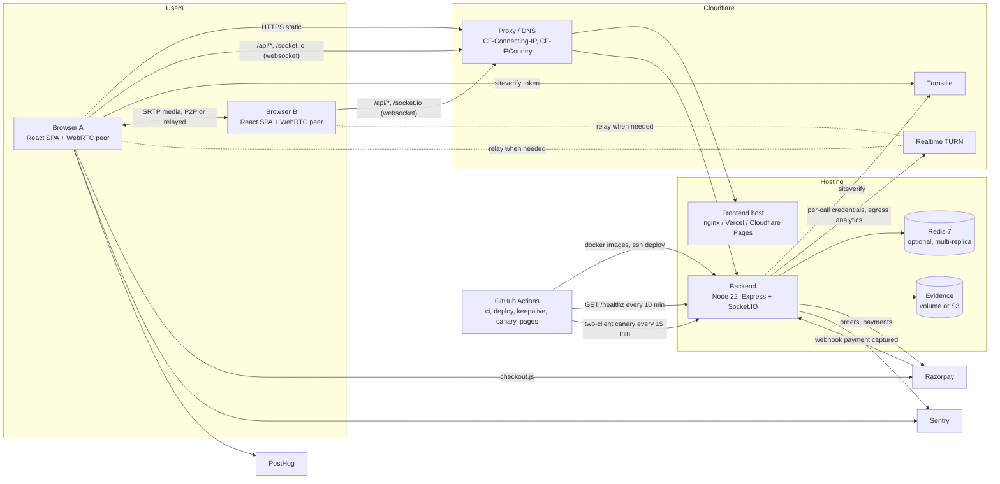

What each outside party does:

| Party | Role | Where it is configured |
|---|---|---|
| Cloudflare proxy | TLS at the edge, real client IP and country headers; the gateway trusts `CF-Connecting-IP` and `CF-IPCountry` only from Cloudflare IP ranges | `deploy/nginx/gateway.conf:64-89`, `TRUST_CLOUDFLARE` in `backend/src/config.ts:52` |
| Cloudflare Turnstile | Bot check on `POST /api/session` (and the takedown form); verified server side with a 5 s timeout, fail closed | `backend/src/session/SessionService.ts:82-93`, `backend/src/session/constants.ts:84-86` |
| Cloudflare Realtime TURN | Relay for calls that cannot connect directly and for "Hide my IP"; per-call short-lived credentials from the TURN API; egress read from GraphQL analytics for the spend cap | `backend/src/turn/cloudflare.ts`, `backend/src/turn/spendPoller.ts` |
| Razorpay | Coin packs (INR). Orders created server side, credited once per order (atomic claim) from either the Checkout verify call or the `payment.captured` webhook | `backend/src/billing/BillingService.ts:1-15` |
| Sentry | Error reporting only, backend and frontend; no tracing, all data collection flags off, events scrubbed | `backend/src/observability/sentry.ts`, `new-frontend/src/lib/observability.ts` |
| PostHog | Seven funnel events from the frontend, memory persistence, no autocapture or session recording | `new-frontend/src/lib/observability.ts` |
| GitHub Actions | CI on every PR; build and deploy on push to `new-v`; keep-alive and canary crons; optional Cloudflare Pages deploy | `.github/workflows/*.yml` |

### 1.1 Topology A: full stack on one host (production)

One EC2 host runs Docker Compose; a push to `new-v` runs CI, pushes images to Docker Hub, then `deploy/deploy.sh` over SSH pulls and does `docker compose up --wait` with health checks and rollback (`DEPLOYMENT.md:3-14`, `.github/workflows/deploy.yml`).

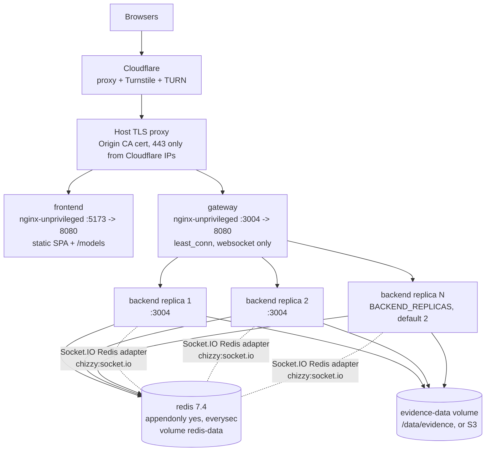

Facts behind the picture:

- `deploy.replicas: ${BACKEND_REPLICAS:-2}` (`docker-compose.yml:135-136`); the gateway resolves the `backend` service name every 10 s so scaling needs no restart (`deploy/nginx/gateway.conf:28`, `README.md:175-176`).
- The gateway uses `least_conn` with no sticky sessions because the client uses the websocket transport only (`gateway.conf:5-9`; client side `new-frontend/src/hooks/useSignaling.ts:443`). `/socket.io/` has `proxy_read_timeout 1h` and `proxy_connect_timeout 1s` (`gateway.conf:137-158`); `/api/` and `/admin/api/` 30 s; `/metrics` returns 404 at the gateway (`gateway.conf:128-130`), it is scraped inside the compose network.
- The gateway sets `X-Real-IP` to the Cloudflare client IP when the peer is a Cloudflare address, otherwise to the TCP peer (`gateway.conf:78-81`, `deploy/nginx/proxy-headers.conf:3-11`). The backend reads it because `TRUST_PROXY=true` and `PROXY_IP_HEADER` defaults to `x-real-ip` (`backend/src/config.ts:30-31`).
- Redis persists with AOF (`docker-compose.yml:34`) and there is a nightly backup script (`scripts/backup-redis.sh`, `README.md:429-430`). No `maxmemory` is set.
- File descriptor limits: `worker_connections 16384`, `worker_rlimit_nofile 65535` on both nginx containers and `ulimits.nofile 65535` on every service (`docs/capacity.md:137-144`).
- Cloudflare Access sits in front of `/admin/api/*` and the `/admin` SPA route in addition to the bearer token (`DEPLOYMENT.md:187-191`).

### 1.2 Topology B: free tier (static SPA + Render single instance)

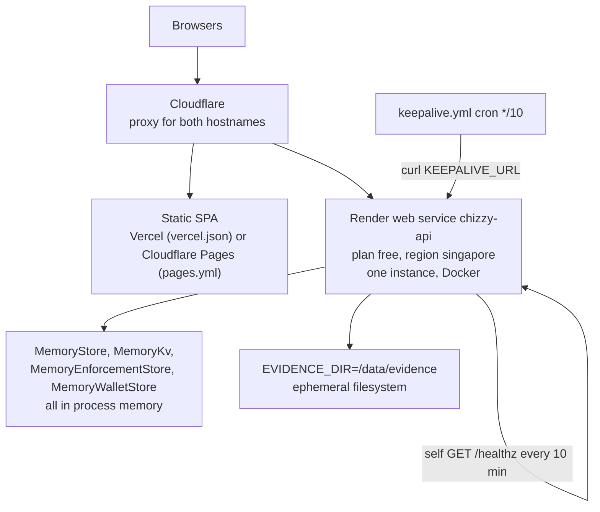

- `render.yaml:20-30`: `type: web`, `runtime: docker`, `plan: free`, `region: singapore`, `healthCheckPath: /healthz`, `autoDeployTrigger: commit`; no `REDIS_URL`, so `index.ts` picks `MemoryStore` (`backend/src/index.ts:45-48`) and every feature store falls back to memory.
- Render stops a free instance after 15 min without a request and takes about a minute to wake (`render.yaml:6-10`). Two keep-alives cover it: the process GETs `KEEPALIVE_URL` (default `<RENDER_EXTERNAL_URL>/healthz`) every 10 min with a 10 s timeout (`backend/src/config.ts:337`, `backend/src/keepalive.ts:14-15`), and `.github/workflows/keepalive.yml` curls the same URL on a `*/10` cron.
- `TURNSTILE_DISABLED=true`, `TRUST_PROXY=true`, `PROXY_IP_HEADER=true-client-ip`, `TRUST_CLOUDFLARE=true` (`render.yaml:31-72`). What this tier gives up: replicas, Redis, TURN until configured, the bot check (`README.md:297-301`). Coin packs need a durable Redis and are not safe on this tier (`README.md:302-309`).
- Vercel Hobby forbids commercial use, so the Vercel mirror is for before payments only; Cloudflare Pages is the intended free production path (`README.md:268-276`).

## 2. Backend internals

### 2.1 Components as wired in `server.ts` and `index.ts`

`backend/src/index.ts` loads config, optionally connects Redis (three clients: the `RedisStore`, the Socket.IO adapter pub/sub pair, and one shared `appRedis` for feature stores, `index.ts:36-44`), then calls `createServer` (`backend/src/server.ts:83-254`), which builds everything below in this order: flags, metrics, session feature, enforcement, billing, HTTP app, Socket.IO server, TURN, safety signals, spend poller, MatchService, Spark, CaptionRelay, socket handlers, matching broadcast.

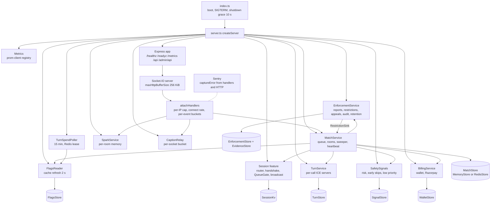

Each store has a memory and a Redis implementation chosen by whether `deps.redis` exists (`server.ts:151,158`; `enforcement/index.ts:45`; `session/index.ts:44`). The emitter sends by socket id through `io.to(socketId)`, so an emit reaches a socket on any replica once the Redis adapter is installed (`realtime/socket.ts:66-80`).

Startup order matters: `listen()` waits for flags to load, the spend poller to start, the first instance heartbeat to be stored and the enforcement retention timer to start (`server.ts:202-209, 221-231`), so no client connects before other replicas can see this instance alive.

### 2.2 Transport and per-socket guards

`backend/src/realtime/socket.ts`:

| Guard | Value | Line |
|---|---|---|
| `maxHttpBufferSize` and parser cap | `MAX_HTTP_BUFFER_SIZE = 256 * 1024` | 43, 58-59 |
| `pingInterval` / `pingTimeout` / `connectTimeout` | 20 000 / 20 000 / 10 000 ms | 60-62 |
| Origin check on every handshake (browsers skip CORS for websockets) | `originAllowed` | 50-52, 57 |
| Session token handshake middleware (`connect_error` `session_required` or `region_blocked`) | `sessionHandshake` | 118, `session/handshake.ts:44-70` |
| Per-IP concurrent connections, per instance | `MAX_CONNECTIONS_PER_IP` default 10 | 119-125, `config.ts:34` |
| New connections per IP, per instance | burst `CONNECT_BURST_PER_IP` 20, refill `CONNECT_RATE_PER_IP_PER_SEC` 1 | 134-142, `config.ts:35-36` |
| Per-socket token buckets by event class | `rateLimit.ts:21-31` (hello 5/0.5 s, preferences 5/1, control 10/2, signal 200/50, chat 10/2, typing 10/4, report 3/0.05, telemetry 20/1) | 171-222 |

Every handler goes through `on()` which validates with the zod schema, rejects `protocolVersion != 3` with `unsupported_version`, replies at most once, and converts a thrown error into `internal` plus a Sentry capture, so a handler can never crash the process (`socket.ts:171-222`).

### 2.3 One call, end to end

Event names are the real ones from `protocol.ts:372-463`. The accept window and TURN timings are quoted in section 2.4.

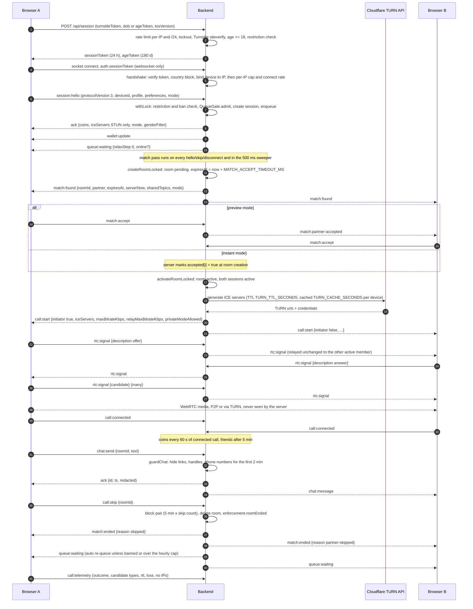

Notes on the sequence, with sources:

- The hello ack is sent inside the match lock, before `queue:waiting` or `match:found`, so the client always sees the ack first (`match/MatchService.ts:241-244, 309-315`).
- A device that connects again from another tab replaces the old socket: the old one gets `session:replaced`, its room ends with `partner-unavailable` for the partner (`MatchService.ts:1019-1024`).
- `call:start` is emitted only after the TURN credential fetch, which runs outside the lock; it is then re-checked under the lock so `call:start` can never follow `match:ended` (`MatchService.ts:864-882`). The Cloudflare TURN API call has a 3 s timeout (`turn/constants.ts:51`); on any failure the call proceeds STUN only (`turn/TurnService.ts:139-143`).
- `rtc:signal` is relayed unchanged, only to the other member of the sender's active room; no lock, a read-only membership check (`MatchService.ts:537-541`). SDP is capped at 20 000 chars and a candidate at 2 000 (`protocol.ts:58-59`).
- Chat is capped at 500 chars (`protocol.ts:56`). The guard hides contact details for `chatGuardMs = 2 min` after call start and sends `safety:nudge` to both sides at most once per kind per room per minute (`match/matchConfig.ts:112`, `safety/constants.ts:45`).
- Coins: `coinsPerInterval = 5` every `coinIntervalMs = 60 000` of connected call, starting balance `initialCoins = 0` (device ids are client-chosen, so a starting balance that covers a day of the gender filter would be a free unlock per fresh device); friends after `friendAfterMs = 5 min` (`config.ts:378-381`). Rewards are driven by the sweeper from stored room state, so they continue whichever replica activated the room (`MatchService.ts:751-756`).
- Pair blocks: decline or accept timeout 30 s, skip 5 min multiplied by the pair's skip count, report 24 h; the record is kept 24 h so repeated skips escalate (`config.ts:377-379`, `MatchService.ts:48-49`).

### 2.4 Session and room state machines

Session states are `idle | waiting | pending | active` and room states `pending | active` (`store/constants.ts:9-11`). Timings come from `config.ts:366-372` and `store/constants.ts`:

| Constant | Value | Source |
|---|---|---|
| `MATCH_ACCEPT_TIMEOUT_MS` (env) | 30 000 ms | `config.ts:37` |
| `matchAcceptGraceMs` | 750 ms | `config.ts:367` |
| `sweepIntervalMs` | 500 ms | `config.ts:368` |
| `recheckIntervalMs` / `recheckPairBudget` | 5 000 ms / 100 000 pair checks | `config.ts:369-370` |
| `heartbeatIntervalMs` / `instanceTtlMs` | 5 000 ms / 15 000 ms | `config.ts:371-372` |
| `PENDING_ROOM_GRACE_MS` (Redis TTL safety net on a pending room) | 60 min after `expiresAt` | `store/constants.ts:39` |
| Active room TTL | none, a call may run for days | `store/constants.ts:35-38` |
| `reportAfterEndMs` | 60 000 ms | `config.ts:380` |

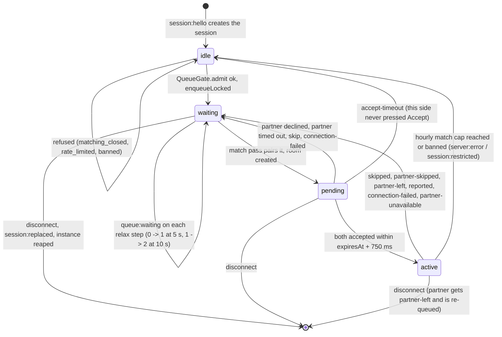

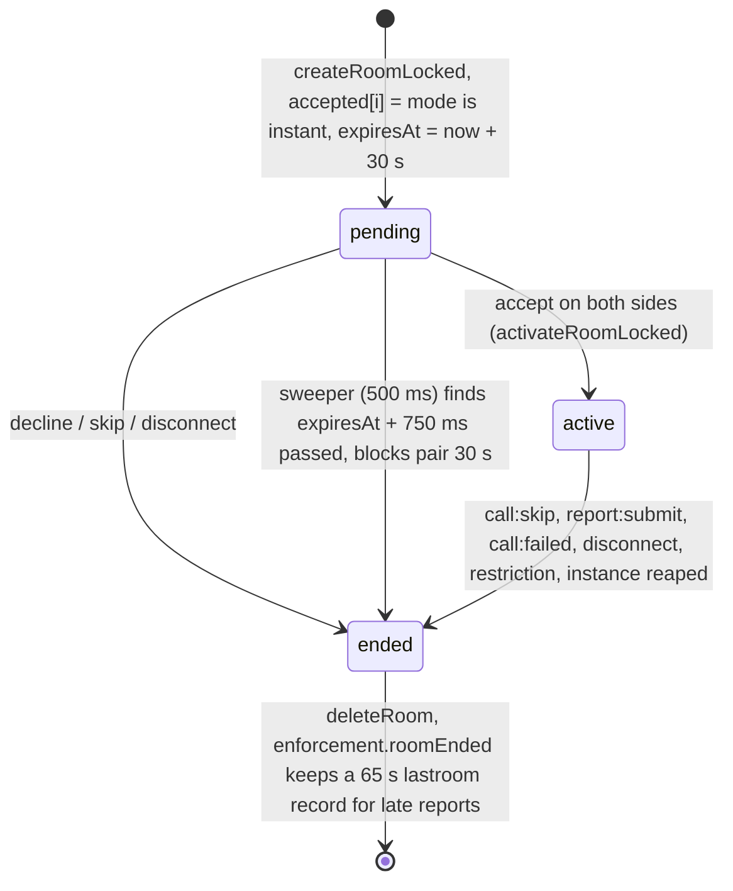

Instance liveness: every replica writes `instance:{id}` with a 15 s TTL every 5 s (`MatchService.ts:183-200`). The sweeper of any live replica removes the sessions of an instance whose key is gone and re-queues their partners with `partner-unavailable` (`MatchService.ts:708-725`). After a Redis outage the store refuses to reap for one full TTL after its next successful heartbeat so peers that reconnect slightly later are not reaped by mistake (`store/RedisStore.ts:28-33, 123-124`).

## 3. Matching engine

All of this is in `backend/src/match/`. Every read-then-write runs under `store.withLock()`; methods named `...Locked` assume the caller holds it (`MatchService.ts:8-11`).

### 3.1 Hard filters, soft preferences, relaxation ladder

- Hard, mutual, never relaxed (`compatibility.ts`): the gender filter (a filter other than `all` needs an active `gender_filter` unlock bought with coins; otherwise the server downgrades it to `all` on every (re)queue and sends `premium_required`, `MatchService.ts:899-904`) and the language filter (primary subtag compare, `en-US` matches `en`). Same device never matches itself.
- Soft, relaxed with waiting time (`relax.ts:1-18`):

| Step | Wait | Requirement |
|---|---|---|
| 0 | 0 to `relaxTopicsAfterMs` = 5 s | shared topic and same primary language (when neither side set a language filter) |
| 1 | 5 to `relaxLanguageAfterMs` = 10 s | same primary language |
| 2 | 10 s and later | anyone passing the hard filters |
| HELD (-1) | first `lowPriorityDelayMs` = 4 s for low-priority devices | not matchable yet; then the ladder runs 4 s late |

  Values: `matchConfig.ts:109-111`. A pair is judged at the more relaxed of the two steps, so a newcomer can match someone who has waited 12 s at once (`relax.ts:12-13, 49-52`).
- Low priority (never a ban) comes from `safety/signals.ts`: a 24 h risk score reaching `riskThreshold = 6` from `moderation:signal` and chat nudges, or an early-skip share above `earlySkipShare = 0.6` once a device has `earlySkipMinCalls = 10` calls (early = partner skipped within `earlySkipMs = 3 s`); it lasts `lowPriorityMs = 60 min` (`matchConfig.ts:113-117`).
- Blocks and bans are checked on top: pair blocks (section 2.3) and the device ban mirrored from an enforcement restriction (`MatchService.ts:1085-1118`).

### 3.2 Incremental matching

The match pass is FIFO: walk waiting sessions oldest first and pair each with the oldest compatible, unblocked, unbanned session after it (`MatchService.ts:1042-1056`). To keep it cheap:

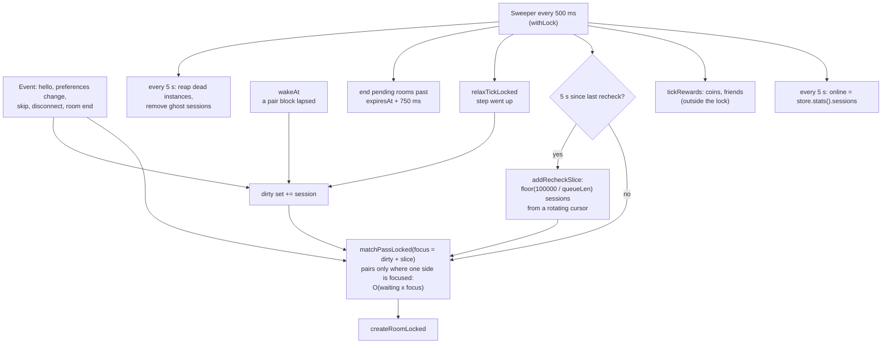

- "Dirty" sessions are the only ones that can form new pairs after an event, so the default pass is `O(waiting x dirty)` instead of `O(waiting^2)`; it yields the same pairs as a full pass except across a block that has lapsed, which `wakeAt` handles (`MatchService.ts:1042-1051`).
- The recheck slice is a safety net for marks this replica never saw (a session queued on another replica, a block changed elsewhere). Its size is `max(1, floor(recheckPairBudget / waiting.length))`, so a queue of 1 000 rechecks 100 sessions every 5 s and a short queue is rechecked whole (`MatchService.ts:1127-1143`).
- The ladder progress (`relaxing`), `dirty` and `wakeAt` are per-replica memory; the queue itself (`waiting` zset) is shared. On graceful shutdown a replica runs one match pass after removing its own sessions so re-queued partners do not wait for another replica's recheck (`MatchService.ts:224-227`).
- The "full" `O(waiting^2)` pass exists for tests only (`MatchService.ts:746-749`).
- Kill switch or outside staffed hours: the queue is kept, nobody is matched (`MatchService.ts:1058-1059`); `QueueGate.admit` also refuses new hellos with `matching_closed`, and refuses with `FULL_MESSAGE` once `waiting >= max_waiting` (flag default 5 000, `protocol.ts:664`; `session/queueGate.ts:36-47`).

### 3.3 The global lock and what it costs

`RedisStore.withLock` is one key, `chizzy:lock:match`, taken with `SET NX PX` and a random token, released by a Lua compare-and-delete (`RedisStore.ts:24-26, 199-229`). Lease `LOCK_TTL_MS = 3 000`, wait `LOCK_WAIT_MS = 10 000`, backoff 4 ms doubling to 50 ms with equal jitter (`store/constants.ts:28-33`). Callers inside one process queue locally first so only one of them polls Redis (`RedisStore.ts:174-197`). A critical section that outlives the lease is logged as an error because another replica may have entered it (`RedisStore.ts:223-228`).

Consequences:

- All matchmaking across all replicas is serialised. Replicas add socket capacity and resilience, not matching throughput.
- Every hello, accept, skip, disconnect and each 500 ms sweep per replica takes the lock; with N replicas the sweepers alone contend 2N times a second.
- Command count per call: not measured. `docs/capacity.md:113-115` states that nothing has been measured for the gateway, Redis (the `lock:match` lock), the session gate or several replicas. The only measured numbers are single process, memory store, local machine, 2026-10-04 (`docs/capacity.md:61-115`): 1 000 sockets used about 100 to 150 MB RSS and under one core even at 68 new calls per second; with 30 s calls every median latency was under 20 ms; event-loop lag p99 was 114 to 213 ms on a machine with load average 61 to 80, so those tails are an upper bound. The pre-launch target (3 000 sockets, 2 replicas, Redis, gateway, 2 h soak) has not been run (`docs/capacity.md:8-11, 117-133`).
- Redis client settings: connect timeout 5 s, command timeout 5 s, 2 retries per request, so an outage fails commands quickly instead of queueing withLock callers for minutes (`store/constants.ts:20-25`).

### 3.4 What "online" means

`queue:waiting.online` is the number of sessions that have sent `session:hello` across all replicas (`store.stats().sessions`, the `chizzy:sessions` set), refreshed by each replica's sweeper every 5 s (`MatchService.ts:138-140, 698-702`). It is sent only when it is at least the `online_count_threshold` flag (default 50, `protocol.ts:677`; `MatchService.ts:916-919`). It is not the number of people in calls and not the number of open sockets.

## 4. Data model

### 4.1 Redis keys (multi-replica mode)

All keys carry a `chizzy:` prefix. Values are JSON documents copied in and out; the stores never hold references.

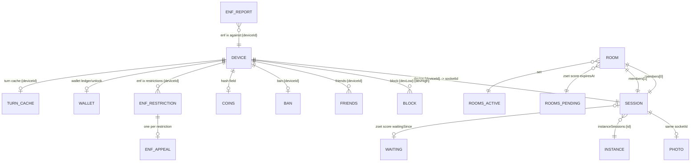

| Namespace | Key | Type | TTL | Source |
|---|---|---|---|---|
| Match | `session:{socketId}` | JSON Session | none (deleted on disconnect, reap or ghost sweep) | `store/RedisStore.ts:4-22` |
| Match | `sessions` | set of socket ids | none | same |
| Match | `photo:{socketId}` | data URL, up to 150 000 chars | none, deleted with the session | same; `protocol.ts:55` |
| Match | `device:{deviceId}` | live socket id | none | same |
| Match | `waiting` | zset socketId -> waitingSince | none | same |
| Match | `room:{roomId}` | JSON Room | pending: `expiresAt - now + 60 min`; active: none | `RedisStore.ts:315-332` |
| Match | `rooms:pending` / `rooms:active` | zset by expiresAt / set | none | same |
| Match | `coins` | hash deviceId -> balance | none | same |
| Match | `friends:{deviceId}` | set of device ids | none | same |
| Match | `block:{devLow}:{devHigh}` | JSON PairBlock | retain time, 24 h (`BLOCK_MEMORY_MS`) | `RedisStore.ts:387-390`, `MatchService.ts:49` |
| Match | `reports` / `reportsAgainst:{deviceId}` | list (max 10 000) / zset | none / 30 days | `store/constants.ts:14, 41` |
| Match | `ban:{deviceId}` | ban expiry | expires at the ban end (`PXAT`); permanent = 100 years | `RedisStore.ts:425-429`, `MatchService.ts:51` |
| Match | `instances`, `instance:{id}`, `instanceSessions:{id}` | set, heartbeat string, set | heartbeat 15 s | `RedisStore.ts:436-477` |
| Match | `lock:match` | lock token | 3 s lease | `RedisStore.ts:199-212` |
| Socket.IO | `chizzy:socket.io` | adapter pub/sub channel | n/a | `realtime/redisAdapter.ts:27` |
| Flags | `chizzy:flags` | hash of overrides | none | `flags/constants.ts:7` |
| Session gate | `chizzy:session:lock:d:{deviceHash}` / `lock:f:{fpHash}` | lockout markers | 365 d / 30 d | `session/constants.ts:46-53, 70-72` |
| Session gate | `chizzy:session:rl:ip:{ipHash}:{min}` / `rl:net:{netHash}:{min}` | fixed-window counters | 1 min | `session/constants.ts:55, 73-74` |
| Session gate | `chizzy:session:cap:d:{deviceId}:{hour}` / `cap:i:{ipHash}:{hour}` / `cap:ipof:{deviceId}` | hourly match caps and device-IP binding | 1 h / 1 h / 24 h | `session/constants.ts:57-59, 75-77` |
| Enforcement | `chizzy:enf:doc:<collection>:<id>` documents, `ix:<name>` sorted-set indexes, `claim|hit|val:<key>` strings, `h:<key>` hashes | reports, restrictions, appeals, takedowns, audit | documents 1 year after they stopped mattering (`RETENTION_MS`), device stats 1 year, fingerprint link 180 d, network facts 24 h, appeal claim 2 years, lastroom 65 s | `enforcement/RedisEnforcementStore.ts:5-7`, `enforcement/constants.ts:95-125` |
| TURN | `chizzy:turn:cache:{deviceId}` / `hit:{key}:{window}` / `ip:{deviceId}` | ICE servers / counters / IP hash | `TURN_CACHE_SECONDS` 300 s / 1 h window / 24 h | `turn/store.ts:7-11`, `turn/constants.ts:21-24` |
| TURN | `chizzy:lock:turn-spend` | poller lease | 0.9 x 15 min, never released | `turn/constants.ts:69-71` |
| Safety | `chizzy:signals:risk:{deviceId}` / `calls:{deviceId}` / `lowpri` | counter / hash / zset | 24 h sliding / 7 d / per entry | `safety/signals.ts:7-10`, `safety/constants.ts:39-41` |
| Wallet | `chizzy:wallet:ledger:{deviceId}` / `unlock:{deviceId}` / `once:order:{orderId}` / `order:{orderId}` | list / hash feature -> expiresAt / idempotency marker / JSON order | none / none / kept for good / 24 h while unpaid (`UNPAID_ORDER_TTL_MS`), kept for good once paid | `billing/WalletStore.ts:10-16` |

Raw IPs and fingerprints are never stored by the session gate; it stores salted hashes derived from `SESSION_SECRET` (`session/constants.ts:60-69`). Admins see a 16-hex-char HMAC pseudonym of a device id, never the id (`enforcement/EnforcementService.ts:204-207`).

### 4.2 What lives only in process memory

Lost on restart of that replica, in both topologies:

| State | Where | Effect of loss |
|---|---|---|
| Relaxation ladder progress, `dirty`, `wakeAt`, recheck cursor, cached `online` | `MatchService.ts:131-156` | sessions this replica queued are re-queued on reconnect anyway; other replicas' rechecks cover the rest |
| Per-socket rate-limit buckets, per-IP connection counts and connect-rate buckets | `realtime/socket.ts:107-108, 156` | buckets start full on reconnect (which is why the connect-rate bucket exists) |
| Spark cooldown and prompt history per room | `spark/SparkService.ts:10-12, 50` | a pair on two replicas may see two cooldown clocks: slightly looser limit |
| Caption rate buckets per socket | `captions/CaptionRelay.ts:33` | none |
| TURN in-flight credential dedupe per device | `turn/TurnService.ts:68-69` | none |
| Safety nudge dedupe sets | `safety/signals.ts` (`DEDUPE_MAX = 50 000`) | a nudge may repeat once |
| Flags cache (2 s refresh) | `flags/flags.ts:166-174` | reloaded at boot from `chizzy:flags` |
| `sessionSecret` when `SESSION_SECRET` is unset (never in production) | `config.ts:349-350` | every session and age token dies with the process |

In topology B (no Redis) everything in section 4.1 is also in memory: sessions, queue, rooms, coins, friends, blocks, bans, reports, restrictions, appeals, audit log, wallet ledger, unlocks, lockouts and rate counters. A Render restart or spin-down empties all of it, and evidence frames written to `/data/evidence` on the ephemeral filesystem are lost too (`render.yaml:11-14`).

## 5. Media path

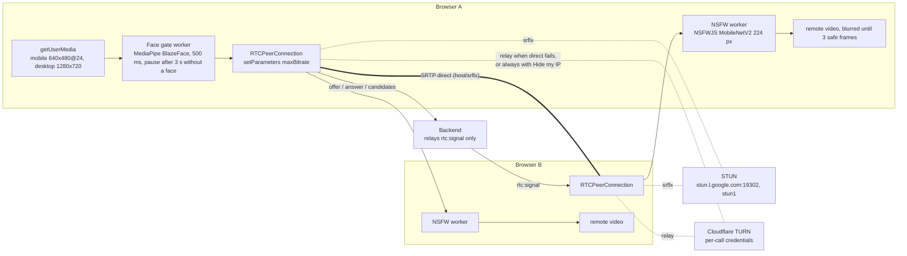

- The server never sees media; it relays `rtc:signal` payloads unchanged to the other active member (`MatchService.ts:537-541`). ICE servers: the hello ack carries STUN only (`TurnService.ts:83-86`, `STUN_URLS` default `stun:stun.l.google.com:19302,stun:stun1.l.google.com:19302`, `config.ts:38`); `call:start` carries STUN plus TURN when a provider is configured, `turn_enabled` is on and the device is under its caps (`TurnService.ts:94-144`).
- TURN providers: `none | static | secret | cloudflare` (`matchConfig.ts:8`). Cloudflare credentials have `TURN_TTL_SECONDS` default 7 200 (`config.ts:43`), are cached per device for `TURN_CACHE_SECONDS` 300 and capped at `TURN_MAX_PER_DEVICE_HOUR` 20 and `TURN_MAX_PER_IP_HOUR` 100; over the cap the call is STUN only (`matchConfig.ts:20-22`, `TurnService.ts:126-133`).
- When TURN is used: the browser gathers all candidate types (`iceTransportPolicy: "all"`) and ICE picks relay only when host and server-reflexive pairs fail. "Hide my IP" sets `iceTransportPolicy: "relay"` so no candidate ever exposes the user's address; it is offered only when `call:start.privateModeAllowed` is true (flag `private_mode_enabled` and `turn_enabled` and credentials issued) and a `turn:`/`turns:` URL is present (`new-frontend/src/lib/connectivity.ts:358-367`, `new-frontend/src/hooks/usePeerConnection.ts:102`, `TurnService.ts:101`).
- Bitrate caps from flags: `video_max_kbps` 900 direct, `relay_video_max_kbps` 500 relayed (`protocol.ts:667-668`). The client applies them with `RTCRtpSender.setParameters({ maxBitrate: kbps * 1000 })`, re-checked every 2 s, and steps down to 400 kbps / 360 px after packet loss above 8 % in 3 samples (`connectivity.ts:14-18, 286-316`). The spend poller lowers the relay cap to 300 kbps at the first threshold (`turn/constants.ts:67`).
- Connection timeouts: 10 s to connect, `restartIce` after 4 s in `disconnected`, one restart on `failed`, then `call:failed` with `timeout` or `ice-failed`; the server ends the room with `connection-failed` and re-queues both (`connectivity.ts:10-12, 95-134`; `protocol.ts:218-219, 358`).
- On-device moderation (`new-frontend/src/moderation/`): the sender's face gate samples a 320 px frame every 500 ms with MediaPipe FaceDetector (BlazeFace short range, CPU, confidence 0.5) and swaps the outgoing track for a blurred placeholder after 3 s without a face, fail-open if the model cannot load (`faceGate.ts:9-10, 40-43`, `useFaceGate.ts:9, 48-50`, `workers/face.worker.ts:26-30`). The receiver classifies the partner's video with NSFWJS MobileNetV2 at 224 px: blurred until 3 consecutive safe frames, sampled every 500 ms for the first 10 s then every 2 s, explicit threshold 0.35 (porn + hentai), sexy 0.7, and a flagged frame hides the video for the rest of the call (`blurGate.ts:12-20, 96-101`, `workers/nsfw.worker.ts`). Models are self-hosted under `/models/` (`modelAssets.ts`). Only counts reach the server as `moderation:signal` kinds `nsfw-blur | no-face | virtual-camera | model-unavailable` (`protocol.ts:240`), feeding the risk score.
- Report evidence is the only frame that ever leaves a browser: the reporter's client captures a 256 px JPEG of the partner's video (quality 0.7 then 0.5 then 0.3 until under 120 000 chars) plus the last 20 chat lines (`new-frontend/src/lib/evidence.ts:14-16, 33-73`, `protocol.ts:60-62`). The server validates the JPEG magic bytes and treats it as unverified (`enforcement/evidence.ts:36-41`, `protocol.ts:192-196`).

### 5.1 Captions

Browser Web Speech `SpeechRecognition` (continuous, interim results, BCP-47 tag per language) transcribes the sender's own microphone; interim segments go out at most every 250 ms per segment id, finals at once, as `caption:segment` (`new-frontend/src/captions/useSpeechCaptions.ts:81-110`, `protocol.ts:78-85`). The server checks the sender is in the active room, enforces 10 segments per second per socket by dropping (no error), caps text at 1 024 UTF-8 bytes, and forwards unchanged; nothing is stored or logged (`captions/CaptionRelay.ts:1-9, 42-55`). The receiving browser translates final segments with Chrome's built-in `Translator` API when the languages differ; the server never sees a translation (`captions/translator.ts`, `useCaptions.ts:114-127`).

## 6. Safety and enforcement

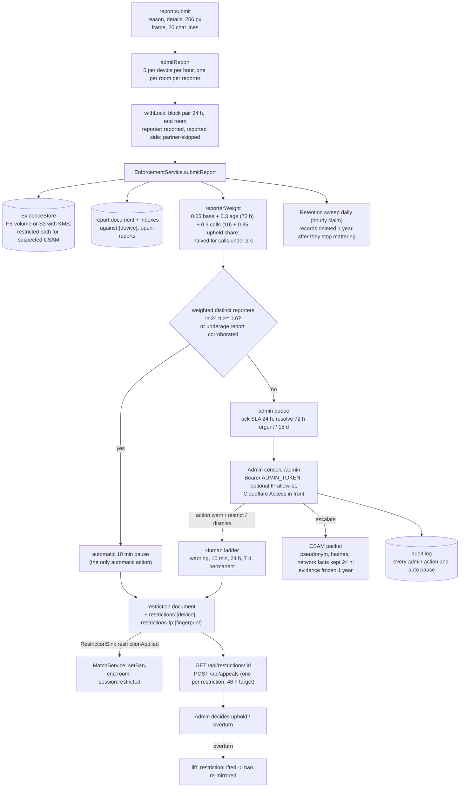

Sources: `enforcement/EnforcementService.ts:1-13` (rules), `:247-252` (admit), `:291-348` (submit), `:373-415` (auto action), `:418-462` (restrict and sink), `:889-909` (retention); `enforcement/constants.ts:27-67` (ladder, thresholds, SLAs), `:73-87` (weights); `enforcement/policy.ts:86-99` (kinds and ladder step); `MatchService.ts:414-465` (report path), `:502-535` (sink). Public and admin routes with their guards are listed in [PROTOCOL.md](PROTOCOL.md).

Other things on the safety side:

- Age and bot gate: `POST /api/session` needs a Turnstile token, a date of birth (18+) or a prior age token, and the current `TOS_VERSION`; an under-18 date locks the device for 365 days and its coarse fingerprint plus /24 network for 30 days (`session/SessionService.ts:64-144`, `session/constants.ts:46-53`). Rates: 10 sessions per IP per minute, 60 per /24 per minute, 200 matches per device and per IP per hour (`config.ts:53-56`).
- Country block: flag `blocked_countries` defaults to the UK, EU/EEA and Australia, checked at session creation and at every socket handshake from the token's country and the edge header (`protocol.ts:670-672`, `session/handshake.ts:54-56`).
- Chat and name guard: links, handles and phone numbers hidden for the first 2 minutes of a call; a display name with contact details or a slur becomes a stable generated nickname `Stranger NNNN` (`safety/guard.ts:232-236`, `safety/constants.ts:27-32`).
- Takedowns: `POST /api/takedowns` with Turnstile; SLA 24 h CSAM, 48 h NCII, 15 days otherwise (`enforcement/constants.ts:59-65`).

## 7. Observability

- Metrics: `GET /metrics` on each replica, Bearer `METRICS_TOKEN` when set, blocked at the gateway (`http/app.ts:70-76`, `gateway.conf:128-130`). prom-client default metrics (`process_*`, `nodejs_eventloop_lag_*`, heap) plus (`metrics.ts`, `match/matchMetrics.ts`): `chizzy_connected_sockets`, `chizzy_sessions`, `chizzy_waiting_sessions`, `chizzy_pending_rooms`, `chizzy_active_rooms`, `chizzy_matches_total`, `chizzy_match_end_total{reason}`, `chizzy_rate_limited_total{event}`, `chizzy_invalid_payload_total{event}`, `chizzy_handler_errors_total{event}`, `chizzy_calls_total{outcome,local_candidate,private}`, `chizzy_time_to_connect_seconds` (buckets 0.25 to 30 s), `chizzy_call_failed_total{reason}`, `chizzy_moderation_signals_total{kind}`, `chizzy_safety_nudges_total{kind}`, `chizzy_chat_redacted_total`, `chizzy_names_replaced_total`, `chizzy_early_skips_total`, `chizzy_low_priority_total{cause}`, `chizzy_turn_credentials_total{result}`, `chizzy_turn_spend_steps_total{step}`, `chizzy_turn_spend_poll_errors_total`, `chizzy_turn_egress_gb_today`, and the session gate's `chizzy_session_requests_total{result}` and `chizzy_handshake_rejected_total{code}` (`session/index.ts:51-62`). No label carries an IP, device id or chat text (`matchMetrics.ts:4`).
- Health: `GET /healthz` always 200; `GET /readyz` pings the store with a 1 s timeout and answers 503 otherwise (`http/app.ts:53-68`). Compose health checks every 10 s; the frontend container answers `/healthz` too.
- Logs: pino JSON to stdout, rotated 10 MB x 3 by Docker (`docker-compose.yml:17-21`). The gateway access log records the Cloudflare client IP and the TCP peer (`deploy/nginx/nginx.conf:36-39`).
- Sentry: backend initialises only with `SENTRY_DSN`, errors only, no performance integrations, 30 breadcrumbs, request reduced to method and path, flushed with a 2 s timeout at shutdown (`observability/sentry.ts:43-79`). The frontend gets `sentryDsn` from `GET /api/config` and loads the SDK when the page is idle (`new-frontend/src/lib/observability.ts`).
- PostHog: frontend only; events `landing_view`, `gate_passed`, `camera_granted`, `first_match`, `match_accepted`, `call_connected`, `third_call`, with `$ip`, URL and referrer denied and no person profiles (`new-frontend/src/lib/observability.ts`).
- Canary: `.github/workflows/canary.yml` runs `scripts/loadtest/canary.ts` every 15 min against `CANARY_URL`; two headless socket clients must both reach `call:start` within 30 s. The Turnstile bypass it expects does not exist on the backend yet (`DEPLOYMENT.md:484`), so it only works against a deployment with `TURNSTILE_DISABLED=true`.
- Keep-alive: see section 1.2.
- TURN spend: one replica (Redis lease) polls Cloudflare analytics every 15 min and steps flags down at `TURN_SPEND_DAILY_GB` thresholds 35, 50, 70 GB per UTC day: relay bitrate 300 kbps, Hide my IP off, TURN off. Steps log at error level and never undo themselves (`turn/spendPoller.ts:1-14`, `matchConfig.ts:26, 107-108`).

## 8. What happens when

| Event | What the code does | What a user sees |
|---|---|---|
| A backend replica is killed (SIGTERM, deploy) | `index.ts` stops the keep-alive, calls `server.close()`: flags and broadcast stop, enforcement sweeper stops, `MatchService.shutdown()` sends `server:shutdown` to local sockets, removes its sessions under the lock (partners get `partner-unavailable` and are re-queued), runs a match pass, forgets the instance, then `io.close()` and waits for running handlers; forced exit after `SHUTDOWN_GRACE_MS` 10 s; compose `stop_grace_period` 15 s (`index.ts:62-88`, `server.ts:232-252`, `MatchService.ts:206-230`, `docker-compose.yml:144`) | Clients on that replica reconnect through the gateway to another replica (1 to 10 s backoff), re-send `session:hello` and are re-queued; their call ends with `partner-unavailable` on the other side |
| A replica dies without SIGTERM (crash, OOM, host loss) | Its heartbeat key expires after 15 s; the next sweep (every 5 s per replica) on a live replica reaps its sessions and re-queues partners (`MatchService.ts:708-725`) | Partner sees `match:ended partner-unavailable` within roughly 15 to 20 s; the victim's socket drops and reconnects |
| Redis blips (seconds) | Commands time out after 5 s with 2 retries; a `withLock` caller waits up to 10 s; the sweep logs `sweep failed` and tries again 500 ms later; disconnect cleanups that fail are repaired by the ghost-session sweep every 5 s; the store re-sends its heartbeat on `ready` and refuses to reap other instances for 15 s after the first successful beat so nobody is reaped for a shared outage (`store/constants.ts:20-33`, `RedisStore.ts:28-33, 134-141`, `MatchService.ts:727-744`) | Hellos and skips during the blip get `internal`; `/readyz` answers 503 (the compose health check uses `/healthz`, so the replica is not restarted); no session data is lost because Redis keeps it |
| Redis is down for longer than 15 s | Every heartbeat expires; on reconnect each replica re-beats, and reaping is suppressed until a full TTL after that, so sessions survive if their replica is still up | Matching is paused for the outage; pending rooms may expire |
| Redis restarts and loses data (no AOF replay) | Sessions, queue, rooms, bans, blocks, coins, friends, flags, session counters, enforcement records and wallets are gone; sockets stay connected but have no session; the next `session:hello` (on reconnect) recreates sessions | Users in calls keep their media (P2P) until someone presses Next, then nothing works until they reconnect; coins and unlocks bought are lost unless restored from the nightly backup (`docs/redis-backup.md`) |
| Render spins the free instance down | Everything in section 4.2 and, with no Redis, section 4.1 is lost; the next request wakes it in about a minute; keep-alives every 10 min are meant to prevent it (`render.yaml:6-10`) | Sockets drop; the client reconnects with backoff until the instance answers, then re-sends hello; tokens survive because they are signed, not stored (unless `SESSION_SECRET` was auto-generated) |
| A deploy rolls (topology A) | `deploy.sh` pulls images and runs `docker compose up -d --wait`, which recreates the backend replicas and waits for every container health check; each replica goes through the graceful path above; the gateway re-resolves `backend` every 10 s; a failed verification restores the previous tag (`DEPLOYMENT.md:360-393`) | A deploy drops live calls: the room ends with `partner-unavailable` because the replica removed its sessions, clients reconnect and are re-queued automatically (`DEPLOYMENT.md:392-393`). Watch for connection errors during the reconnect storm (`docs/capacity.md:106-112`) |
| A user's socket reconnects (network change, tab sleep) | The client reconnects with `reconnectionDelay` 1 s up to 10 s, re-reads the session token, re-sends `session:hello` with the latest profile and preferences; the server treats the new socket id as a new session, replaces the old one (`session:replaced` to the old socket if it is still there), and ends any room with `partner-unavailable` for the partner (`useSignaling.ts:443-515`, `MatchService.ts:285-298, 1019-1024`) | The call ends and both sides are re-queued; the pair is not blocked, so they may match again. Pending `rtc:signal`s buffered on the client are dropped (`useSignaling.ts:497`) |
| The session token expires (24 h) | The handshake fails with `connect_error` `session_required`; the client invalidates the token, goes back through the gate (`POST /api/session`, reusing the 180 d age token so no date of birth is asked again) and reconnects (`useSignaling.ts:509-515`, `SessionService.ts:116-126`) | A Turnstile check, then back to the queue |
| The flags change (kill switch, staffed hours, banner) | Each replica refreshes its cache within 2 s and pushes `matching:status` and `server:banner` to its own sockets; the match pass matches nobody while closed and `QueueGate.admit` refuses new hellos (`flags/constants.ts:9`, `session/broadcast.ts`) | A status message; waiting users stay in the queue until matching reopens |
| TURN spend crosses a threshold | The poller patches flags; new `call:start`s carry the lower relay cap, no Hide my IP, then no TURN at all; an operator restores the flags from the admin API (`turn/spendPoller.ts`) | Calls behind symmetric NATs fail with `connection-failed` once TURN is off |
| An enforcement restriction is applied mid-call | `restrictionApplied` mirrors the ban into the match store, ends the room (`restricted` for the device, `partner-skipped` for the partner), sends `session:restricted`, and the device is not re-queued (`MatchService.ts:502-529`) | The restricted user sees the reason and an appeal link; the partner is re-queued |
