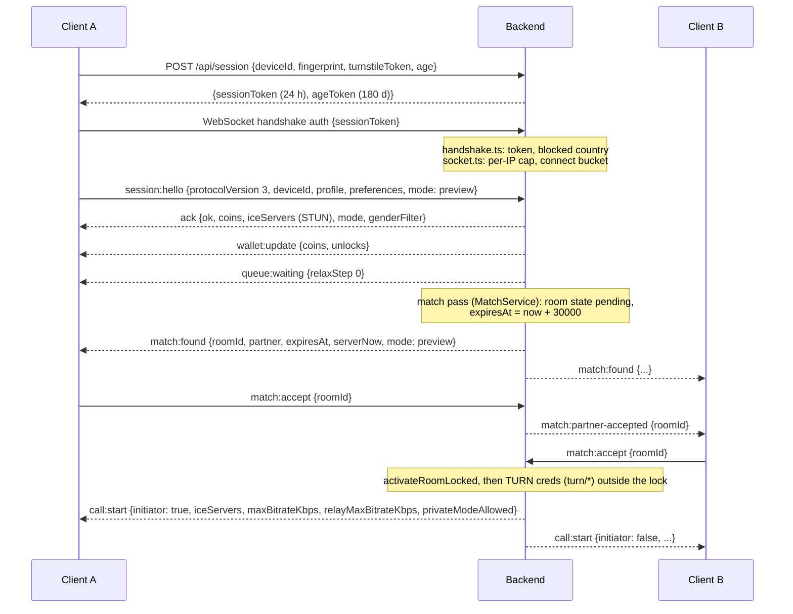
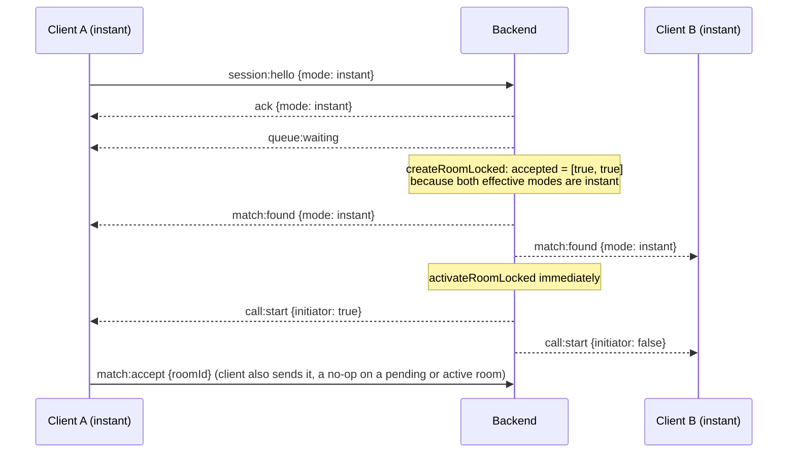
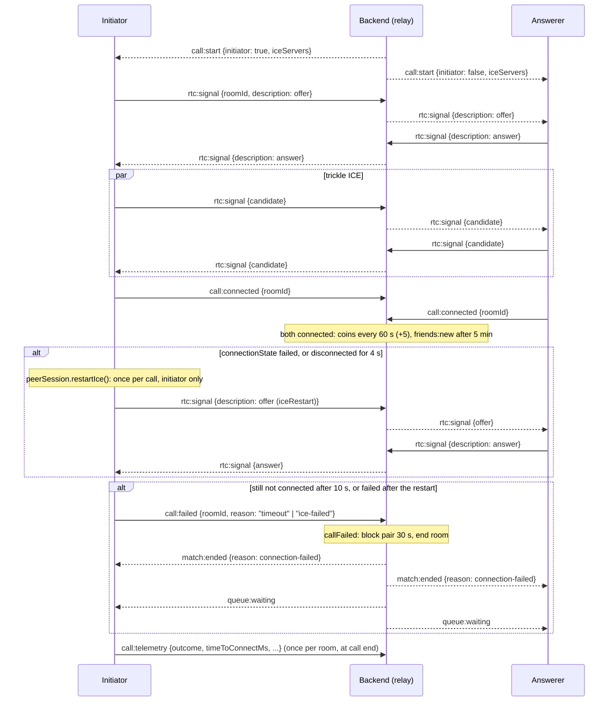
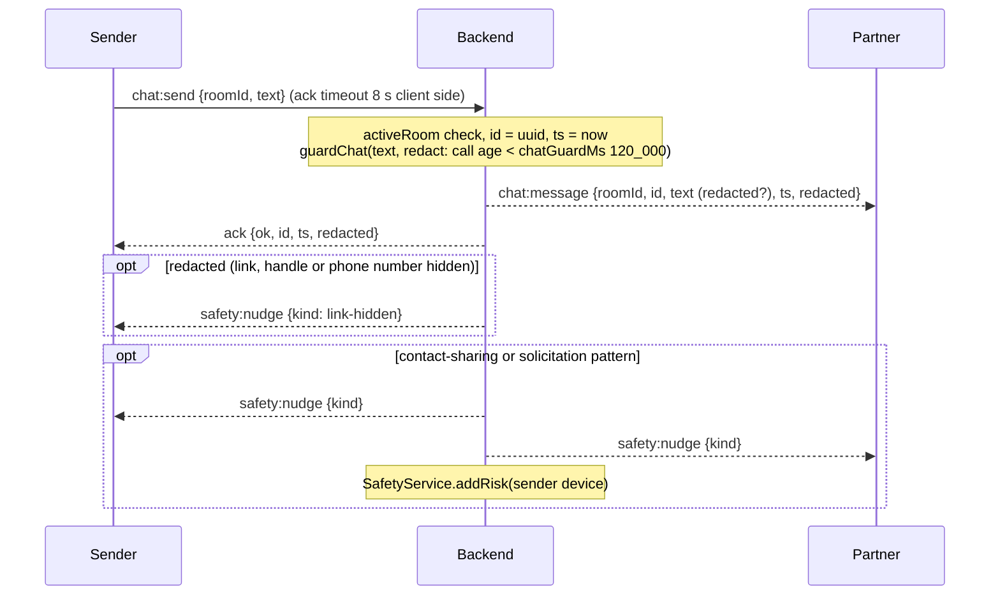
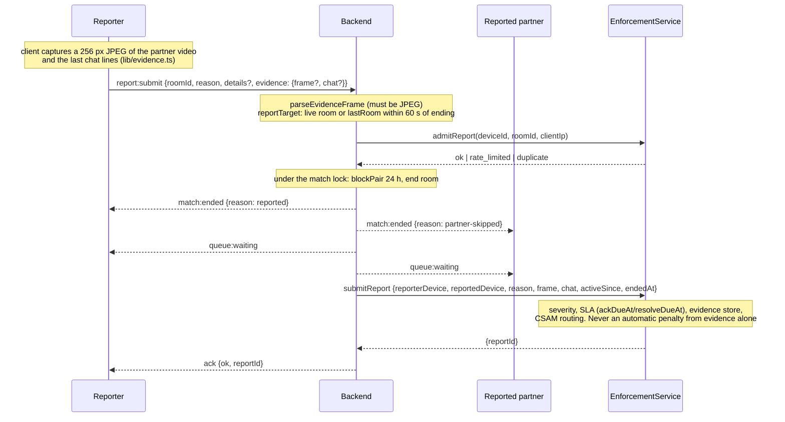
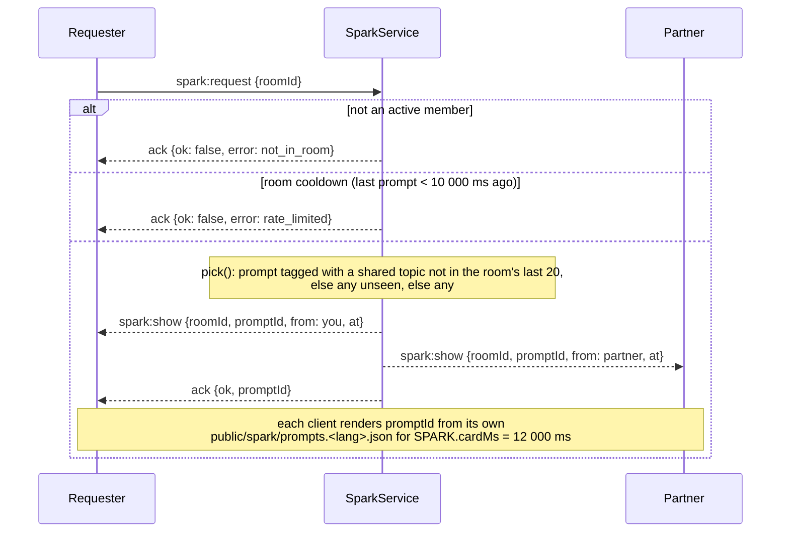
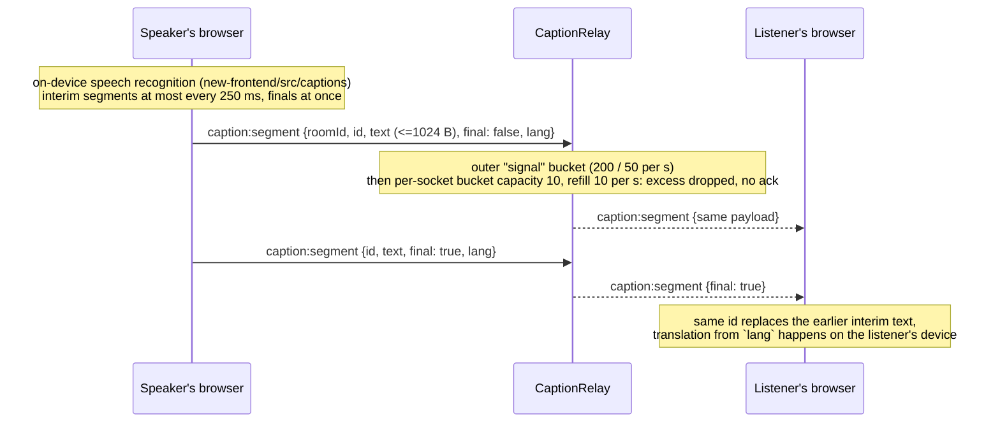
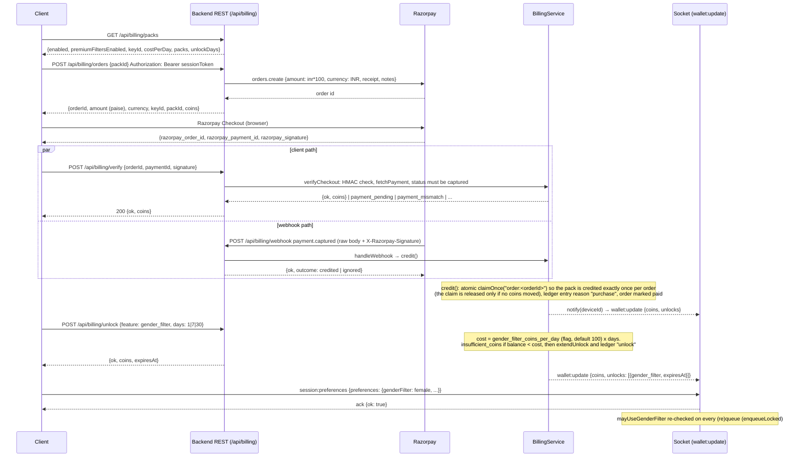
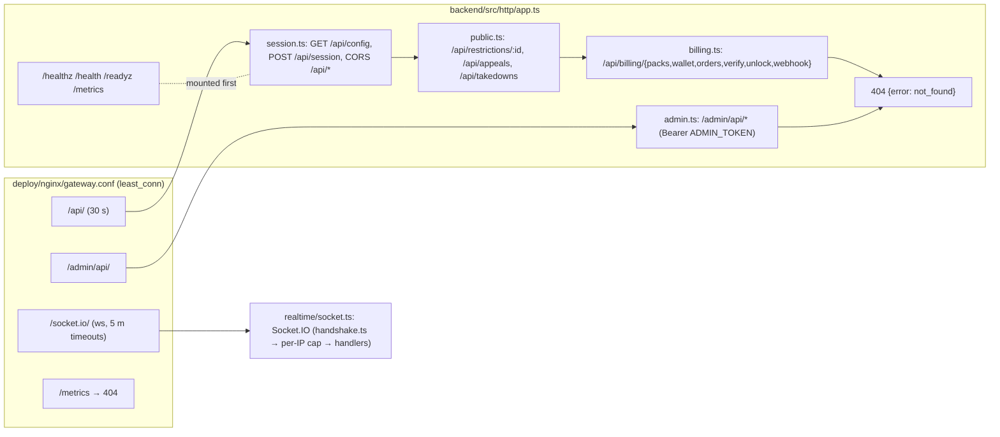
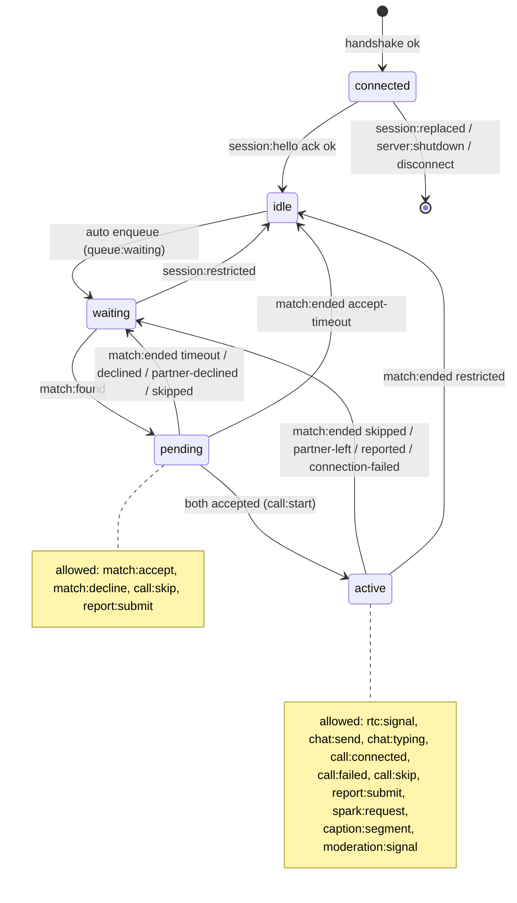

# Chizzy wire protocol

Everything a client and the backend say to each other: the Socket.IO transport, every socket event with its payload, the REST API, and the rules for changing any of it. Every number below is quoted from the file named next to it; nothing is estimated.

Related: [ARCHITECTURE.md](ARCHITECTURE.md) (how the pieces fit together) and [LIMITS.md](LIMITS.md) (capacity, caps and durations).

Source of truth: `backend/src/protocol.ts` (`PROTOCOL_VERSION = 3`). The frontend uses a byte-for-byte copy at `new-frontend/src/lib/protocol.ts` (see [Versioning](#6-versioning-and-compatibility)).

## 1. Transport

### 1.1 Socket.IO over WebSocket only

| Item | Value | Source |
|---|---|---|
| Library | Socket.IO 4 server (`socket.io`), client `socket.io-client` | `backend/src/realtime/socket.ts`, `new-frontend/src/hooks/useSignaling.ts` |
| Path | Socket.IO default `/socket.io/`; the gateway proxies that prefix with 1 h read/send timeouts and `proxy_connect_timeout 1s` | `deploy/nginx/gateway.conf` `location /socket.io/` |
| Transports | server: `transports: ["websocket"]` (long polling is never served; a polling handshake gets HTTP 400 "Transport unknown"); client: `transports: ["websocket"]` (no long-polling, no upgrade) | `socket.ts` `createSocketServer`, `useSignaling.ts` `io(API_URL, …)` |
| Why websocket only | the gateway uses `least_conn` with no sticky sessions; long-polling would need every poll of one session to hit the same replica. `ip_hash` is not an option because behind the EC2 host proxy all traffic arrives from one address | header comment of `deploy/nginx/gateway.conf` |
| CORS | `cors.origin` = `CORS_ORIGINS` (`*` only outside production); browsers do not apply CORS to WebSocket upgrades, so `allowRequest` re-checks the `Origin` header on every upgrade and answers HTTP 400 `origin not allowed`. Requests without `Origin` are allowed | `socket.ts` `originAllowed`, `config.ts` (`CORS_ORIGINS` required and must not contain `*` in production) |
| Per-IP cap and connect rate | also in `allowRequest`, before any Engine.IO connection exists (see 1.2) | `socket.ts` `ConnectionGate` |
| Max packet | `MAX_HTTP_BUFFER_SIZE = 256 * 1024` bytes, applied as `maxHttpBufferSize` and inside `limitedParser` | `socket.ts` |
| limitedParser | a `socket.io-parser` `Decoder` subclass: throws on any non-string chunk, on `BINARY_EVENT`/`BINARY_ACK` packets, on packets over 256 KiB, and when the connection's packet budget (`PACKET_RATE_PER_CONNECTION`: 400 burst, 100/s) or byte budget (`PACKET_BYTES_PER_CONNECTION`: 1 MiB burst, 128 KiB/s) runs out. A throw makes Socket.IO close that connection before any handler runs. It exists because under Bun the `ws` `maxPayload` limit is not enforced, because binary attachment counts could be abused to buffer unbounded frames, and because every packet is JSON-parsed before the per-event buckets see it (unknown events never reach a bucket) | `backend/src/realtime/limitedParser.ts`, `rateLimit.ts` |
| Heartbeat | server `pingInterval: 20_000`, `pingTimeout: 20_000`, `connectTimeout: 10_000` (ms) | `socket.ts` `createSocketServer` |
| Hello deadline | a connected socket that has not sent a well-formed `session:hello` within `helloTimeoutMs` (30 s, `config.ts`) is disconnected (`chizzy_rate_limited_total{event="hello_timeout"}`); a malformed hello does not stop the clock | `socket.ts` `attachHandlers` |
| Multi-instance | `io.to(socketId).emit` through the Redis adapter, so an emit reaches a socket held by another replica | `socket.ts` `createEmitter`, `realtime/redisAdapter.ts` |

### 1.2 Handshake

The upgrade is checked in `allowRequest` first, then the connection goes through two `io.use` middlewares (`socket.ts` `createSocketServer`, `attachHandlers`):

0. Per-IP cap and connect rate (`socket.ts` `ConnectionGate.admit`, in `allowRequest`). Client IP = `PROXY_IP_HEADER` (default `x-real-ip`) when `TRUST_PROXY=true` and the header holds exactly one IP literal (`session/geo.ts` `requestIp`; IPv4-mapped prefix and IPv6 zone id dropped), else the TCP peer. A missing or malformed header (a list, a hostname, junk) never becomes an identity; `x-forwarded-for`/`forwarded`/`via` are refused at boot because clients can prepend to them. A refusal is an HTTP 400 on the upgrade whose body names the reason; no Engine.IO connection, Socket.IO client or session-gate work exists for it, and the Socket.IO client reports a generic `websocket error`.
   - Open connections per IP >= `MAX_CONNECTIONS_PER_IP` (default `10`, `config.ts`) → 400 `too_many_connections`. Connections are counted from the engine's `connection` event and released on its `close`.
   - Connect token bucket per IP: capacity `CONNECT_BURST_PER_IP` (default `20`), refill `CONNECT_RATE_PER_IP_PER_SEC` (default `1`) → 400 `rate_limited`. Full buckets are pruned every 60 s.
1. Session gate (`backend/src/session/handshake.ts` `sessionHandshake`). Reads `socket.handshake.auth.sessionToken`, verifies it with `TokenSigner.verifySession` (signed token from `POST /api/session`, TTL `SESSION_TOKEN_TTL_MS = 1 day`, `session/constants.ts`). Missing or invalid: `connect_error` with `data.code = "session_required"`. Then the country from the token and the current `cf-ipcountry` header (only trusted with `TRUST_CLOUDFLARE=true`) are both checked against the `blocked_countries` flag: `data.code = "region_blocked"`. On success `socket.data.session = { deviceId, country, expiresAt }` and the device is bound to the IP for the hourly match caps (`caps.bindIp`; a store failure here is logged and ignored). The token is not re-checked later; instead `attachHandlers` arms one timer per socket for `expiresAt` (cleared on disconnect): at the token's expiry the socket gets `server:error` `{ code: "session_expired" }` and is then disconnected by the server (client reason `io server disconnect`), so no socket outlives its token.
2. Per-session socket cap (`socket.ts` `attachHandlers`): more than `MAX_SOCKETS_PER_SESSION` (3, `rateLimit.ts`) open sockets for the token's `deviceId` on this instance → `connect_error` "too_many_connections". Skipped when the session gate is off, and for a client whose connection already closed while the session gate awaited `caps.bindIp` (its `close` has fired, so counting it would hold the slot forever; Socket.IO discards such a socket after `next()`).

A middleware refusal (1 or 2) sends `CONNECT_ERROR` and then closes the connection on the next tick; Socket.IO would otherwise keep it open for `connectTimeout` in case the client joins another namespace, which this server does not have.

The client (`useSignaling.ts`) supplies `auth` as a function so every (re)connect sends the current token. On `connect_error` with `session_required` or `region_blocked` it invalidates the stored session, waits for a new `POST /api/session` to succeed (`waitForSession()`), then calls `socket.connect()` again. Socket.IO does not retry handshake rejections by itself.

### 1.3 `session:hello` and protocol version

After `connect` the client sends `session:hello` with `protocolVersion: PROTOCOL_VERSION` (3). The server checks that field before zod parsing (`socket.ts` `isWrongVersion`): a mismatch acks `{ ok: false, error: "unsupported_version", message: "protocolVersion must be 3" }`. The client dispatches `hello-failed` with that error and shows it; there is no automatic downgrade. The hello also fails with `invalid_payload` when `deviceId` differs from the one inside the session token.

### 1.4 Client reconnection (`useSignaling.ts`)

| Setting | Value |
|---|---|
| `reconnection` | `true` |
| `reconnectionDelay` | `1000` ms |
| `reconnectionDelayMax` | `10000` ms (Socket.IO's default randomisation factor applies; not overridden) |
| ack timeout (`socket.timeout(...)`) | `ACK_TIMEOUT_MS = 8000` ms for `session:hello`, `chat:send`, `session:preferences`, `report:submit`, `spark:request` |
| `MAX_PENDING_SIGNALS` | `200` `rtc:signal` packets buffered before the peer session for that room is created |

What is re-sent on reconnect: only `session:hello`, built at connect time from the latest profile, preferences and mode (`sayHello` runs on every `connect`). Pending `rtc:signal` buffers are cleared on `disconnect`, `match:found` and `match:ended`. A `disconnect` with reason `io server disconnect` (deploy, `server:shutdown`) calls `socket.connect()` manually because Socket.IO does not reconnect after a server-initiated close. After `session:replaced`, a `banned` ack/error, or unmount the hook sets `stopped` and never reconnects.

Server side, a disconnect ends any room with `partner-left` for the partner and removes the session (`MatchService.disconnect`); there is no server-side session resumption, so the client always starts from `session:hello` → `queue:waiting`.

### 1.5 Per-event rate classes (`backend/src/rateLimit.ts`)

One token bucket per class per socket; each event takes one token; an empty bucket answers `rate_limited` (ack if the event has one, else `server:error`). Events with no handler (unknown names, acks for nothing) are ignored by Socket.IO without reaching a bucket; only the per-connection packet budget (1.1) bounds them.

| Class | Capacity | Refill per second | Events |
|---|---|---|---|
| `hello` | 5 | 0.5 | `session:hello` |
| `preferences` | 5 | 1 | `session:preferences` (an unchanged preference set is acknowledged without touching the queue) |
| `control` | 10 | 2 | `match:accept`, `match:decline`, `call:connected`, `call:skip`, `spark:request` |
| `signal` | 200 | 50 | `rtc:signal`, `caption:segment` (outer bucket; `CaptionRelay` adds its own `CAPTIONS.maxPerSec = 10` bucket) |
| `chat` | 10 | 2 | `chat:send` |
| `typing` | 10 | 4 | `chat:typing` |
| `report` | 3 | 1/20 | `report:submit` |
| `telemetry` | 20 | 1 | `call:failed`, `call:telemetry`, `moderation:signal` |

### 1.6 Handler contract (`socket.ts` `on()`)

Order per incoming event: rate limit → (hello only) version check → zod `safeParse` (`invalid_payload`) → handler. A handler that throws before replying produces `internal`. The ack is sent at most once; events without an ack callback report failures through `server:error`. All handlers run in the background and are tracked so graceful shutdown waits for them (`Handlers.idle()`).

## 2. Event catalogue

Types below are the zod schemas / TypeScript interfaces in `backend/src/protocol.ts`. `roomId` is always a UUID string. "Who" is enforced by the handler in `backend/src/match/MatchService.ts` unless another module is named.

### 2.1 Client → server

| Event | Payload | Ack | Class | Who | Handler |
|---|---|---|---|---|---|
| `session:hello` | `{ protocolVersion: 3, deviceId: uuid, profile: Profile, preferences: Preferences, mode: "instant" \| "preview" }` | `HelloAck`: `{ ok: true, coins: number, iceServers: IceServer[] (STUN only), mode: MatchMode, genderFilter: GenderFilter }` or error (`banned` carries `restriction`) | hello | any connected socket | `MatchService.hello` (gate: `session/queueGate.ts`) |
| `session:preferences` | `{ preferences: Preferences }` | `SimpleAck`; `premium_required` when `genderFilter != "all"` without an active unlock; `bad_state` before hello | preferences | after hello | `MatchService.updatePreferences` |
| `match:accept` | `{ roomId }` | none | control | member of a `pending` room; after `expiresAt + matchAcceptGraceMs (750 ms)` answers `server:error not_in_room` "the match expired" | `MatchService.accept` |
| `match:decline` | `{ roomId }` | none | control | member of a pending room | `MatchService.decline` (pair blocked `declineBlockMs = 30_000`) |
| `call:connected` | `{ roomId }` | none | control | member of the active room; once per side | `MatchService.connected` (coins/friends start when both sent it) |
| `call:skip` | `{ roomId }?` (optional; a mismatching roomId is ignored) | none | control | member of pending or active room | `MatchService.skip` (pair blocked `skipBlockMs = 5 min`) |
| `rtc:signal` | `RtcSignal`: `{ roomId, description?: { type: "offer" \| "answer", sdp: string<=20_000 }, candidate?: { candidate<=2_000, sdpMid?<=64, sdpMLineIndex? 0..64, usernameFragment?<=256 } }`, exactly one of the two | none | signal | member of the **active** room; otherwise silently dropped | `MatchService.signal` (relayed unchanged to the partner) |
| `chat:send` | `{ roomId, text: trimmed 1..500 }` | `ChatAck`: `{ ok: true, id: uuid, ts: epoch ms, redacted: boolean }`; `not_in_room` | chat | member of active room | `MatchService.chat` (+ `safety/chatGuard`) |
| `chat:typing` | `{ roomId, typing: boolean }` | none | typing | member of active room | `MatchService.typing` |
| `report:submit` | `ReportPayload`: `{ roomId, reason: ReportReason, details?<=500, evidence?: { frame?: JPEG data URL <=120_000 chars, chat?: Array<{ from: "me" \| "partner", text<=500, ts }> <=20 } }` | `ReportAck`: `{ ok: true, reportId }`; `not_in_room`, `rate_limited`, `bad_state` "already reported", `invalid_payload` "evidence frame must be a JPEG" | report | member of the room, or either device within `reportAfterEndMs = 60_000` after it ended; once per room per reporter; 5 per device and 30 per client IP per hour (the IP is `session/geo.ts` `socketIp`: null when unknown, so unknown-IP reporters share no bucket) | `MatchService.report` → `enforcement/EnforcementService.submitReport` |
| `call:failed` | `{ roomId, reason: "ice-failed" \| "timeout" }` | none | telemetry | member of active room | `MatchService.callFailed` (ends with `connection-failed`, pair blocked 30 s, both re-queued) |
| `call:telemetry` | `{ roomId, outcome: "connected" \| "ice-failed" \| "timeout" \| "ended-before-connect", timeToConnectMs?, durationMs?, localCandidateType?, remoteCandidateType?, privateMode: boolean, rttMs?, packetLossPct?, freezeCount? }` | none | telemetry | any socket that said hello; once per room per socket (last 20 remembered) | `MatchService.telemetry` (Prometheus only) |
| `moderation:signal` | `{ roomId, kind: "nsfw-blur" \| "no-face" \| "virtual-camera" \| "model-unavailable" }` | none | telemetry | sender's current room | `MatchService.moderationSignal` → `safety/SafetyService` |
| `spark:request` | `{ roomId }` | `SparkAck`: `{ ok: true, promptId }`; `not_in_room`; `rate_limited` during the room cooldown `SPARK.cooldownMs = 10_000` | control | member of active room | `spark/SparkService.request` |
| `caption:segment` | `{ roomId, id: /^[A-Za-z0-9_-]{1,64}$/, text: 1..1024 UTF-8 bytes, final: boolean, lang: language code }` | none; over `CAPTIONS.maxPerSec = 10` segments or `CAPTIONS.maxBytesPerSec = 2048` bytes per second the segment is dropped silently | signal | member of active room; links, handles and phone numbers hidden during the first `chatGuardMs` of the call as in chat | `captions/CaptionRelay.segment` |

`Profile` = `{ name: 1..32, country: /^[A-Z]{2}$/, language: /^[a-z]{2,3}(-[A-Za-z0-9]{2,8})?$/, gender: "male" | "female" | "other" | "unspecified", topics: 1..10 of TOPICS, photo?: data:image/(jpeg|png|webp) data URL <= 150_000 chars }`. `Preferences` = `{ genderFilter: "all" | "male" | "female" | "other", languageFilter: "any" | language code }`.

### 2.2 Server → client

| Event | Payload | When | Emitted by |
|---|---|---|---|
| `queue:waiting` | `{ relaxStep: 0 \| 1 \| 2, online?: number }` (`online` only when at least `online_count_threshold` (flag default 50) are online) | after hello, after every `match:ended` re-queue, on each relaxation step | `MatchService` |
| `match:found` | `{ roomId, partner: PublicProfile (Profile without gender), isFriend, expiresAt, serverNow, sharedTopics: Topic[], mode }` | a pair was formed; `expiresAt = now + MATCH_ACCEPT_TIMEOUT_MS` (default `30000`) | `MatchService.createRoomLocked` |
| `match:partner-accepted` | `{ roomId }` | the other side accepted (or was in instant mode) | `MatchService.accept` / `createRoomLocked` |
| `match:ended` | `{ roomId, reason: MatchEndReason }` | see reason table below | `MatchService.endRoomLocked` |
| `call:start` | `{ roomId, initiator: boolean, iceServers: IceServer[] (STUN + per-call TURN), maxBitrateKbps, relayMaxBitrateKbps, privateModeAllowed }` | both accepted; sent after TURN credentials were fetched, only if the room is still active | `MatchService.startCall` (`turn/*`) |
| `rtc:signal` | `RtcSignal` (as sent by the partner) | relay | `MatchService.signal` |
| `chat:message` | `{ roomId, id, text, ts, redacted }` | partner sent `chat:send` | `MatchService.chat` |
| `chat:typing` | `{ roomId, typing }` | relay | `MatchService.typing` |
| `coins:update` | `{ balance, delta }` | every `coinIntervalMs = 60_000` of connected call, `coinsPerInterval = 5` | `MatchService` sweeper |
| `friends:new` | `{ roomId }` | both sides after `friendAfterMs = 5 min` of call | sweeper |
| `session:replaced` | none | the same `deviceId` said hello from another socket; this one is disconnected next | `MatchService.replaceLocked` |
| `server:shutdown` | none | this replica is closing; the socket is closed next and the client reconnects | `server.ts` `close()` |
| `server:error` | `{ code: ErrorCode, message? }` | a rejected event without an ack | `socket.ts` `fail`, `MatchService` |
| `safety:nudge` | `{ roomId, kind: "contact-sharing" \| "solicitation" \| "link-hidden" }` | chat guard (`link-hidden` to the sender only; the other two to both) | `MatchService.chat` |
| `server:banner` | `{ message: string \| null }` | the `banner_message` flag changed (checked every `matchingStatusIntervalMs = 30_000`) | `session/broadcast.ts` |
| `matching:status` | `{ open, reopensAt, message }` | kill switch / staffed hours changed | `session/broadcast.ts` |
| `session:restricted` | `{ restriction: Restriction }` | an admin applied a restriction to this device; any room is ended first (`restricted` / partner sees `partner-skipped`) | `MatchService.restrictionApplied` |
| `wallet:update` | `WalletView = { coins, unlocks: Array<{ feature: "gender_filter", expiresAt }> }` | right after the hello ack, and after every purchase, unlock or admin adjustment, to the device's live socket on any replica | `server.ts` `notify` → `BillingService.push` |
| `spark:show` | `{ roomId, promptId, from: "you" \| "partner", at }` | both members, same instant | `SparkService.request` |
| `caption:segment` | `CaptionSegmentPayload` | relay of the partner's transcript | `CaptionRelay.segment` |

`MatchEndReason` (`protocol.ts`): `declined`, `partner-declined`, `timeout` (partner never accepted; you are re-queued), `accept-timeout` (you never accepted; you go idle, not re-queued), `skipped`, `partner-skipped`, `partner-left`, `reported`, `partner-unavailable`, `connection-failed`, `restricted`. After `match:ended` the server re-queues automatically except for `accept-timeout` and restrictions (`MatchService` lines around `requeue`).

### 2.3 Error codes (`ErrorCode`, `protocol.ts`)

| Code | Meaning | Where |
|---|---|---|
| `invalid_payload` | zod parse failed, or `deviceId` differs from the session token, or the evidence frame is not a JPEG | `socket.ts`, hello, report |
| `rate_limited` | per-socket bucket empty; hourly match cap (`CAP_MESSAGE`); per-minute skip cap (`MINUTE_CAP_MESSAGE`, `MATCH_CAP_PER_DEVICE_PER_MIN` default 20 rooms ended by the device's own `call:skip`/`match:decline`; a re-queue after `partner-skipped`, `partner-left` or `partner-declined` is never refused by it); accept-timeout cooldown ("You let 3 matches expire…", `ACCEPT_TIMEOUT_*` in `safety/constants.ts`); report quota; Spark cooldown | `socket.ts`, `queueGate.ts`, `MatchService.hello`, `SparkService` |
| `not_in_room` | the room is not the sender's, is not active, or the accept window has passed | chat, report, spark, accept |
| `bad_state` | hello not sent yet, deviceId change on a live socket, duplicate report, socket gone during hello | `MatchService` |
| `unsupported_version` | `protocolVersion !== 3` | `socket.ts` |
| `banned` | an active pause/ban restriction; ack carries `restriction` when known | `MatchService.hello` |
| `matching_closed` | `matching_enabled` off, outside `staffed_hours`, or waiting >= `max_waiting` (flag default 5_000) | `queueGate.ts` |
| `session_required` | handshake without a valid session token | `handshake.ts` (connect_error) |
| `session_expired` | the session token of a connected socket expired; sent once as `server:error` right before the server disconnects the socket. Mint a new session (`POST /api/session`, with the age token) and reconnect | `socket.ts` (session-expiry timer) |
| `region_blocked` | country in `blocked_countries` | `handshake.ts` (connect_error) |
| `premium_required` | `genderFilter != "all"` without an active `gender_filter` unlock | `updatePreferences` |
| `internal` | handler threw | `socket.ts` |

## 3. Sequence diagrams

### 3a. Connect, hello, queue, match

Preview mode (both press Accept inside the `MATCH_ACCEPT_TIMEOUT_MS = 30000` window):

If only one side accepts before `expiresAt + 750 ms`, the sweeper (`sweepIntervalMs = 500`) ends the room: the accepter gets `match:ended {reason: "timeout"}` and is re-queued; the other gets `accept-timeout` and stays idle (`MatchService.runSweep`). Each side that never pressed Accept also gets a strike (`SafetySignals.acceptTimedOut`); the third strike within 10 minutes starts a 60 s cooldown during which `session:hello` answers `rate_limited` (`ACCEPT_TIMEOUT_STRIKES`, `ACCEPT_TIMEOUT_WINDOW_MS`, `ACCEPT_TIMEOUT_COOLDOWN_MS` in `safety/constants.ts`). Instant-mode sides are accepted by the server and never strike.

Instant mode (`mode: "instant"`, or the `default_mode` flag forcing nothing; a `preview` flag overrides both sides to preview, `effectiveMode`):

Mixed: an instant member is pre-accepted; the preview member receives `match:partner-accepted` at once and must still accept.

### 3b. WebRTC signalling, ICE restart, `call:failed`

Client logic: `new-frontend/src/lib/peerSession.ts` (one offer/answer, one ICE restart per call by the initiator), `new-frontend/src/lib/connectivity.ts` (`CONNECT_TIMEOUT_MS = 10_000`, `DISCONNECTED_RESTART_MS = 4_000`), `new-frontend/src/hooks/usePeerConnection.ts`.

The server never parses SDP; `rtc:signal` is forwarded only to the other member of the sender's **active** room (`MatchService.signal` → `activePartner`). Signals that arrive before the client has created its peer session are buffered client-side (up to 200).

### 3c. Chat message with ack and redaction

Redaction only applies during the first `chatGuardMs = 2 * 60_000` ms of the call (`backend/src/match/matchConfig.ts`); `safety:nudge` is de-duplicated by `SafetyService.shouldNudge`.

### 3d. Report with evidence

The reported side is told `partner-skipped`, never that a report happened (`MatchService.report`). Admin follow-up happens over `/admin/api/reports/:id/action`; a `restrict` action ends in `session:restricted` on the reported device if it is online (`restrictionApplied`).

### 3e. Spark request and show

The cooldown map is per replica (`SparkService` header comment): with several instances a pair can, at worst, see two prompts within one cooldown.

### 3f. Caption segment relay

Segments are never stored or logged (`protocol.ts` `captionSegmentSchema` comment, `CaptionRelay`). Buckets are dropped on disconnect (`forget`).

### 3g. Wallet: order → Razorpay Checkout → verify / webhook → `wallet:update` → unlock → preferences

Sources: `backend/src/http/billing.ts`, `backend/src/billing/BillingService.ts`, `backend/src/server.ts` (`notify`), `MatchService.updatePreferences` / `enqueueLocked`.

## 4. REST API

All routes live on the backend origin (same as the socket). `backend/src/http/app.ts` mounts health/metrics first, then the session router (which adds CORS for `/api/*`: `Access-Control-Allow-Origin` for allowed origins, `Access-Control-Max-Age: 600`), then the public, billing and admin routers (`backend/src/server.ts`), then a JSON 404. Bodies are JSON unless stated; every router (session, public, billing, admin) parses through `backend/src/http/body.ts` (`jsonBody`, and `rawBody` for the billing webhook), which refuses an over-cap `Content-Length` before reading the body (413 with `Connection: close`) and any `Content-Encoding` (415). "Per-instance" buckets are `IpBuckets` in `backend/src/http/public.ts` (cleared when they exceed 50 000 keys). Client IP comes from `PROXY_IP_HEADER` when `TRUST_PROXY=true` and it holds one IP literal, else the TCP peer (section 1, step 2; `X-Forwarded-For` is refused by `config.ts`). The http server runs with the deadlines in `backend/src/http/constants.ts` (headers 15 s, whole request 30 s, idle keep-alive 65 s, 100 headers, 1 000 requests per socket).

### 4.1 Health and metrics (`backend/src/http/app.ts`)

| Route | Auth | Response | Notes |
|---|---|---|---|
| `GET /healthz`, `GET /health` | public | `{ status: "ok" }` | liveness; `Cache-Control: no-store` |
| `GET /readyz` | public | `{ status: "ready" }` or 503 `{ status: "unavailable" }` | `store.ping()` with `readyTimeoutMs` (default 1000 ms); concurrent requests share one ping |
| `GET /metrics` | `Authorization: Bearer METRICS_TOKEN`; without `METRICS_TOKEN` the route is open outside production and 404 in production | Prometheus text; `Cache-Control: no-store` | the gateway returns 404 for `/metrics` publicly (`gateway.conf`); scrape replicas directly |

### 4.2 Session gate (`backend/src/http/session.ts`, `backend/src/session/SessionService.ts`)

| Route | Auth | Body | Response | Limits |
|---|---|---|---|---|
| `GET /api/config` | public | — | `PublicConfig`: `{ tosVersion, turnstileSiteKey, sentryDsn, posthogKey, posthogHost, banner, matchingOpen, staffedHours, reopensAt, defaultMode, privateModeEnabled }` | `Cache-Control: public, max-age=30` |
| `POST /api/session` | public (Turnstile token unless `TURNSTILE_SECRET` is unset) | `SessionRequest`: `{ deviceId: uuid, fingerprint: sha256 hex, turnstileToken?<=4096, age: { dob: YYYY-MM-DD, attest18: true, tosVersion } \| { ageToken, tosVersion } }` | 200 `{ ok: true, sessionToken, sessionExpiresAt, ageToken, ageExpiresAt, country }` or `{ ok: false, error: SessionError, restriction? }` | body `SESSION_BODY_LIMIT_BYTES` 8 KiB (413 / 415 → `invalid`); `SESSION_RATE_PER_IP_PER_MIN` default `10`, `SESSION_RATE_PER_NETWORK_PER_MIN` (IPv4 /24, IPv6 /48) default `60`, fixed 1-minute windows; `TURNSTILE_MAX_INFLIGHT` 64 Siteverify calls in flight, beyond that 503 `closed` |

Checks run in this order (`SessionService.create`): rate limit (`rate_limited` 429) → `new_sessions_enabled` flag (`closed` 503) → `blocked_countries` (`region_blocked` 403) → device/fingerprint lockout (`locked` 403; device lockout 365 days, fingerprint 30 days) → Turnstile (`turnstile_failed` 403, 5 s timeout fails closed) → age: DOB under 18 → `underage` 403 and lockout; `tosVersion !== TOS_VERSION ("2026-10-draft")` → `tos_outdated` 400; bad or foreign `ageToken` → `age_token_invalid` 401; active restriction (`EnforcementService.activeForDevice` by device id and by the fingerprint, which it links to the device for 180 days so a restriction follows the browser to a fresh device id) → `banned` 403; a `ban` placed in the last 6 h on a device that minted its session from the same IPv4 address or IPv6 /64 (`EnforcementService.activeForNetwork`; pauses and warnings never count) → `banned` 403 with that restriction, `appealable: false`, `evidenceAvailable: false` and `until` set to the end of the 6 h; for a date-of-birth request only, more than `SESSION_NEW_DEVICES_PER_NETWORK_PER_DAY` (50) distinct new device ids from that address this UTC day (`NewDeviceCap`, `session/limits.ts`) → `rate_limited` 429. On success the device's IP and edge country are noted for 24 h (CSAM packets, and the address a later ban is carried to). Status map: `session/constants.ts` `SESSION_ERROR_STATUS`. The date of birth is never stored.

### 4.3 Enforcement, public (`backend/src/http/public.ts`)

| Route | Auth | Body / query | Response | Per-instance limit |
|---|---|---|---|---|
| `GET /api/restrictions/:id?deviceId=` | public (knowing both UUIDs) | — | `RestrictionView`: `{ restriction: Restriction, evidenceFrame: string \| null }`; 400 `invalid`, 404 `not_found` | reads: capacity 30, refill 0.5/s per IP |
| `POST /api/appeals` | public | `AppealRequest`: `{ restrictionId: uuid, deviceId: uuid, text: 10..1000 }` | 201 `{ ok: true, appealId }`; 400 `invalid`, 404 `not_found`, 409 `already_appealed` / `not_appealable`, 429 `rate_limited` | writes: capacity 10, refill 0.1/s per IP; body `16kb` |
| `POST /api/takedowns` | public (Turnstile) | `TakedownRequest`: `{ kind: "ncii" \| "csam" \| "impersonation" \| "other", contactEmail, description: 20..2000, location?<=500, isAffectedPerson: boolean, goodFaithStatement: true, turnstileToken? }` | 201 `{ ok: true, ticketId }`; 400 `invalid`, 403 `turnstile_failed`, 429 `rate_limited` | same writes bucket; body `16kb` |

Store-backed per-device limits are applied again inside `EnforcementService`.

### 4.4 Billing (`backend/src/http/billing.ts`, mounted at `/api/billing`)

"session" = `Authorization: Bearer <sessionToken>` (the same token used for the socket handshake); failure → 401 `session_required` with `WWW-Authenticate: Bearer`. Error → HTTP status: `BILLING_STATUS` in `billing/BillingService.ts`: `billing_disabled` 503, `session_required` 401, `invalid` 400, `rate_limited` 429, `unknown_pack` 404, `order_unknown` 404, `bad_signature` 403, `payment_mismatch` 409, `payment_pending` 409, `insufficient_coins` 402, `upstream` 502.

| Route | Auth | Body | Response | Limit (per instance) |
|---|---|---|---|---|
| `GET /api/billing/packs` | public | — | `BillingPacksResponse`: `{ enabled, premiumFiltersEnabled, keyId, costPerDay, packs: CoinPack[], unlockDays: [1,7,30] }`; `max-age=30` | reads 30 / 0.5 per s per IP |
| `GET /api/billing/wallet` | session | — | `{ ok: true, coins, unlocks }` | reads |
| `POST /api/billing/orders` | session | `{ packId }` | `BillingOrder`: `{ ok: true, orderId, amount (paise), currency: "INR", keyId, packId, coins }`; the record of an unpaid order is kept 24 h (`UNPAID_ORDER_TTL_MS`), a paid one for good | writes 10 / 0.1 per s per IP **and** 5 / 1 per 5 min per device; body `8kb` |
| `POST /api/billing/verify` | session | `{ orderId<=64, paymentId<=64, signature<=256 }` | `{ ok: true, coins }` | 20 / 1 per s **per device** (carrier NAT) |
| `POST /api/billing/unlock` | session | `{ feature: "gender_filter", days: 1 \| 7 \| 30 }` | `{ ok: true, coins, expiresAt }` | writes |
| `POST /api/billing/webhook` | Razorpay HMAC over the raw body (`X-Razorpay-Signature`, `RAZORPAY_WEBHOOK_SECRET`) | raw, `64kb` | `{ ok: true, outcome: "credited" \| "ignored" }` or 403 `bad_signature`, 400 `invalid`, 404 `order_unknown`, 409 `payment_mismatch`, 503 `billing_disabled` | 60 / 1 per s per IP |

Packs and the per-day price come from the flags `coin_packs` (default `[{"id":"week","coins":700,"inr":99},{"id":"month","coins":3000,"inr":299}]`) and `gender_filter_coins_per_day` (default `100`); `premium_filters_enabled: false` makes the filter free. New devices start with `initialCoins = 0` (`config.ts`): device ids are client-chosen, so a starting balance that reaches the daily price would hand every fresh device a free unlock (the backend warns when the two values cross). A credit is decided once per order: a second captured payment for the same order (a Razorpay duplicate, refunded from the dashboard) is not credited again. An unlock is checked when preferences are set and again on every (re)queue; a filter that lapses while the device is already waiting or in a call keeps applying until that queue entry ends.

### 4.5 Admin (`backend/src/http/admin.ts`, mounted at `/admin/api`)

Guard, in order: 503 `admin_disabled` when `ADMIN_TOKEN` is unset (required in production, >= 32 chars there, >= 24 elsewhere); 403 `forbidden` when `ADMIN_ALLOWED_IPS` is set and the IP is not in it (IP addresses and CIDR blocks, matched with `net.BlockList`; an unset list in production logs a startup warning); 429 with `Retry-After` when the subscriber address (IPv4 address, IPv6 /64) has `ADMIN_MAX_AUTH_FAILURES_PER_IP = 10` bad tokens within `ADMIN_AUTH_FAILURE_WINDOW_MS = 15 min`, or, once `ADMIN_MAX_AUTH_FAILURES_GLOBAL = 100` bad tokens from all addresses together fell within `ADMIN_GLOBAL_FAILURE_WINDOW_MS = 1 h` of the first one (per instance; logged once at error, `admin_auth_budget_exhausted`), when the address had at least one bad token in that window (an address without one is still judged by its token; only when `ADMIN_FAILURE_MAP_MAX = 50,000` addresses are on record are unrecorded ones refused too) (`http/constants.ts`); 401 `unauthorized` on a bad `Authorization: Bearer ADMIN_TOKEN` (constant-time compare); 429 when the per-IP request bucket (capacity 120, refill 2/s) is empty. CORS preflight allows `GET, POST, PUT, OPTIONS`. DEPLOYMENT.md recommends Cloudflare Access in front of this prefix. JSON bodies capped at `16kb`. Ids that are not UUIDs are 404 without touching the store. `AdminResult` errors: 404 `not_found`, 409 `conflict`, 403 `restricted`. Every mutating call writes an `AdminAuditEntry`.

| Route | Query / body | Response |
|---|---|---|
| `GET /queue?status=open\|acknowledged\|actioned\|dismissed\|escalated\|all` | — | `AdminReport[]` |
| `GET /reports/:id` | — | `AdminReport` |
| `GET /reports/:id/evidence` | — | `image/jpeg` bytes; 403 `restricted` for CSAM-routed reports (never served) |
| `POST /reports/:id/action` | `AdminReportAction`: `{ action: "acknowledge" \| "dismiss" \| "warn" \| "restrict" \| "escalate_csam", reason?: RestrictionReason, durationMs?: 600000 \| 86400000 \| 604800000 \| null (`RESTRICTION_DURATIONS_MS`; null = permanent; omitted = next ladder rung), note?<=2000 }` | result of the action |
| `POST /reports/:id/escalate` | `{ note?<=2000 }` | result |
| `GET /appeals` | — | `AdminAppeal[]` |
| `POST /appeals/:id/decision` | `{ decision: "uphold" \| "overturn", note? }` | result |
| `GET /takedowns` | — | `AdminTakedown[]` |
| `POST /takedowns/:id/resolve` | `{ resolution: 1..2000 }` | result |
| `GET /flags` | — | `Flags` (all keys in `FLAG_DEFAULTS`) |
| `PUT /flags` | partial `Flags`, strict (unknown keys → 400), at least one key | full `Flags`; audited as `flags.update` |
| `GET /audit?limit=1..500 (100)&before=<ts>` | — | `AdminAuditEntry[]` |
| `GET /wallets/:deviceId` | — | `AdminWalletView`: `{ deviceId, coins, unlocks, ledger: WalletLedgerEntry[] }` |
| `POST /wallets/:deviceId/adjust` | `{ delta: non-zero int within ±1_000_000, note: 1..500 }` | `AdminWalletView`; audited as `wallet.adjust` |
| `GET /billing/orders?limit=` | — | `BillingOrderRecord[]`, newest first |

### 4.6 Route map

## 5. Who may send what (room membership)

`session:preferences`, `call:telemetry` and a repeated `session:hello` are accepted in any state after the first hello (a re-hello mid-call only updates the profile; `MatchService.hello`).

## 6. Versioning and compatibility

- `backend/src/protocol.ts` is the only hand-edited copy. `scripts/sync-protocol.sh` copies it to `new-frontend/src/lib/protocol.ts`; `scripts/sync-protocol.sh --check` runs in CI (`.github/workflows/ci.yml`) and fails the build when the two files differ.
- `PROTOCOL_VERSION` (currently `3`) is a `z.literal` in `helloSchema`; the server rejects any other value with `unsupported_version` before validating the rest of the hello. There is no negotiation: the deployed frontend and backend must carry the same number. Bump it for any change a client cannot ignore (renamed or removed event, changed required field, changed semantics of an existing field).
- Additive changes (a new optional field, a new server → client event) do not need a bump. Existing code shows the pattern: `call:skip`'s payload is optional "so older clients that send nothing keep working", and the client tolerates a missing `genderFilter` in `HelloAck` ("An older server may not say which filter it applied").
- `TOS_VERSION` (`"2026-10-draft"`) is versioned separately; a change forces every device to re-accept the Terms through `tos_outdated`.
- `FLAG_DEFAULTS`/`flagsSchema` are part of the protocol file because the admin console and `PUT /admin/api/flags` share them.

How to add a client → server event:

1. Add the zod schema and payload type in `protocol.ts`, the signature in `ClientToServerEvents`, and any new `ErrorCode` or ack type.
2. Register it in `backend/src/realtime/socket.ts` with `on(event, <rate class>, schema, handler)`. Pick an existing class from `rateLimit.ts` or add one with its bucket spec.
3. Implement the handler in the owning service (`MatchService`, `SparkService`, `CaptionRelay`, …). Derive socket id, room membership and timestamps on the server; never trust them from the payload.
4. Run `sh scripts/sync-protocol.sh`, then handle the event in `new-frontend/src/hooks/useSignaling.ts` (or via `subscribe()` for server → client events).
5. Bump `PROTOCOL_VERSION` only if an old client would misbehave; otherwise keep the field optional.
6. Add the event to the tables in this document.
